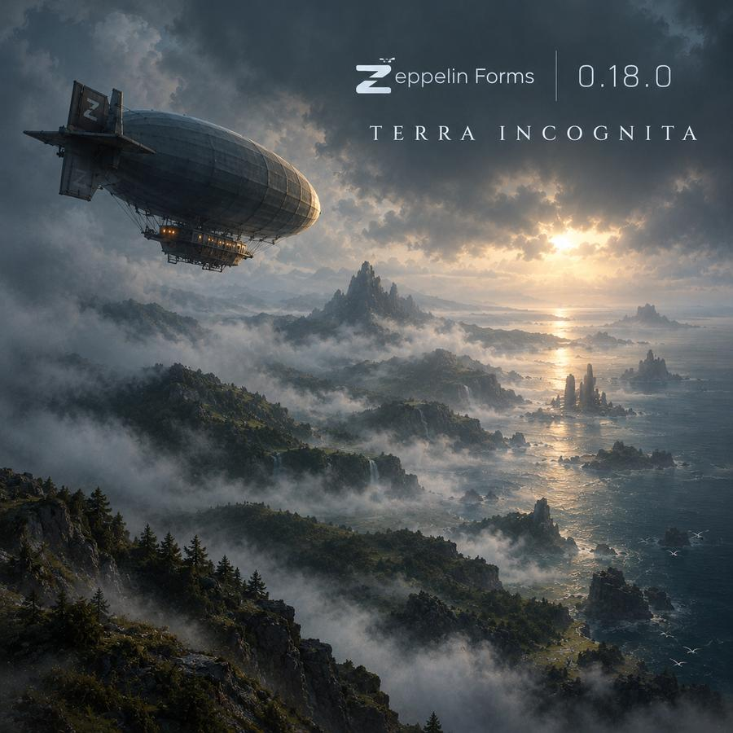
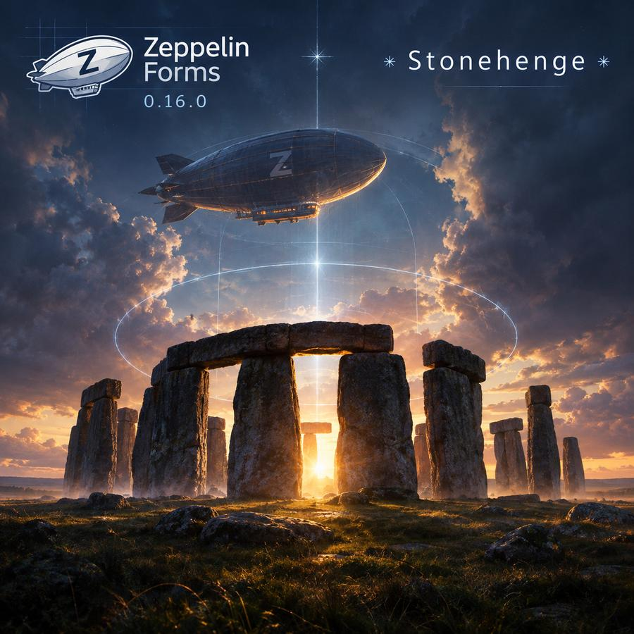
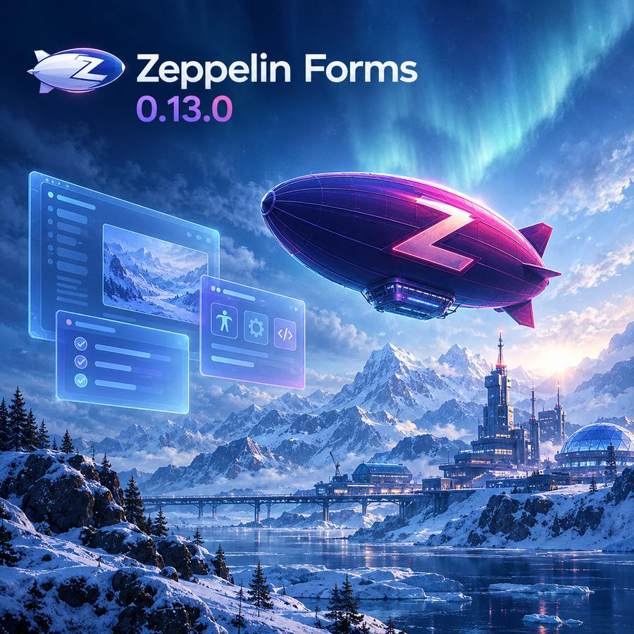
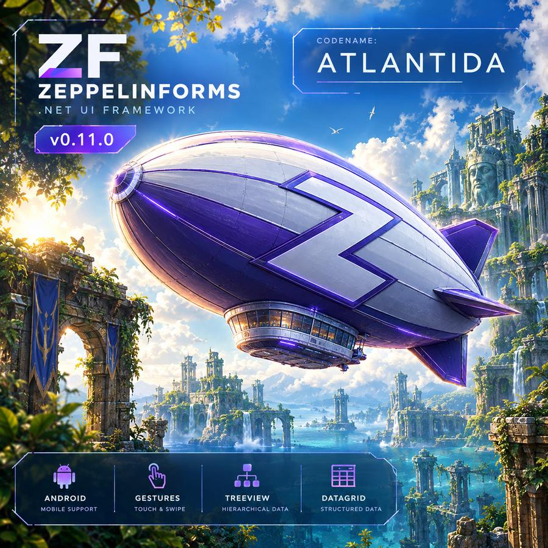
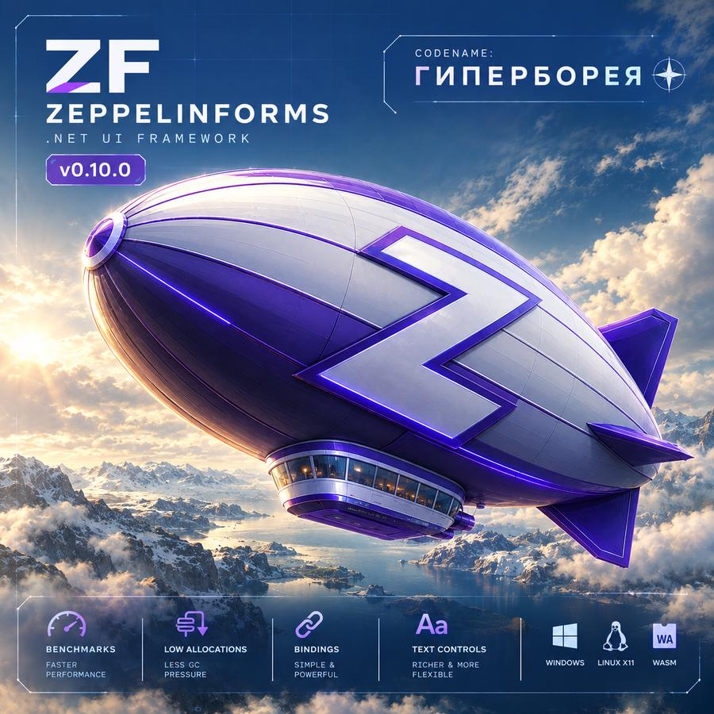
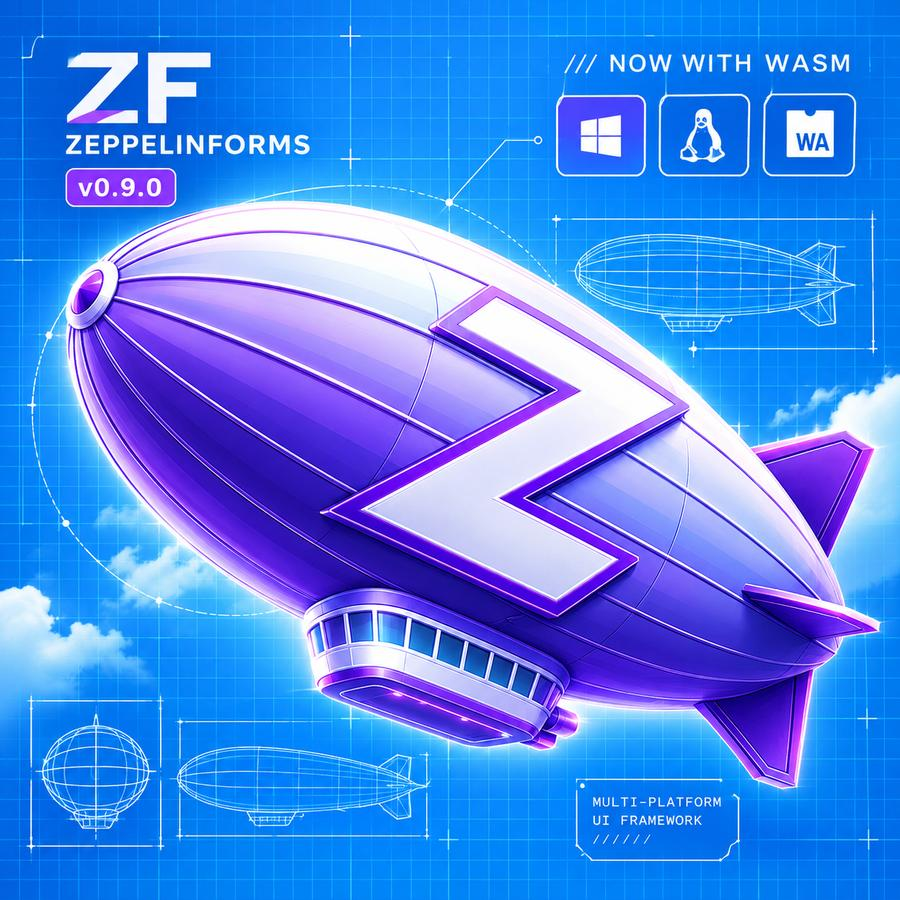

# Changes

## [0.19.0] Nevada

### Breaking changes

- In markup a plain `Name="…"` makes a field of the element, as `x:Name` does (and as WPF
  and Avalonia take `Name`). A class whose code already has a member of that name gets
  the compiler's CS0102; a name that can't be a field — `main-panel` — still only names
  the element
- Removed what was obsolete since 0.13–0.16: `MaskDefinition.Phone` (use `RussianPhone` or a
  pattern of your own), `RichLabel.ContentAlign` and `ContentVerticalAlign` (use
  `HorizontalContentAlign` and `VerticalContentAlign`), `PropertyGrid.RowTextColor` (the
  names take `NameColor`, which the theme sets)

### Markup

- A `.zfml` file needs no namespace declarations: `<Form Class="MyApp.MainForm" Title="…">`
  is a whole root. `Class` names the class as `x:Class` does; `x:Class`, `x:Name` and the
  `xmlns` lines are still understood
- A class the markup alone declares is public
- A wiki section and a README example of a whole form in markup; the showcase's Markup
  page opens one, `FeedbackForm.zfml`

### Tooltips

- A tooltip is a `ToolTip` control, styled by the theme: the surface, a hairline edge, the
  overlay rounding (8 in Fluent) and a soft shadow, the text as the type ramp's caption in
  the theme's text color. It was a border with a black edge and a fixed pale fill, light in
  a dark theme too. A style sheet reaches it by its type: `ToolTip { … }`, `ToolTip Label { … }`
- A long text wraps at `ToolTip.MaxContentWidth`, 320 by default, instead of running across
  the window
- It fades in, unless motion is reduced. Any overlay with an `EnterTransition` now does
- `UIElement.ToolTipContent`: a tooltip of any content, lent to it while shown
- `UIElement.ToolTipDelay`: an element's own delay over the form's `ToolTipDelay`
- The keyboard focus shows its element's tooltip while the form is worked from the keyboard,
  under the element; a key closes a tooltip as a pointer press does, a modifier alone doesn't
- A tooltip goes away with its element instead of hanging where the element was

### The application and its taskbar button

- `App.Id`, `App.DisplayName` and `App.Version` — read from the entry assembly until set:
  `App.Version` is the project's `<Version>` without the SDK's "+commit". The id is the
  window class on X11 (there was none, and docks showed the window apart from its launcher),
  the app_id on Wayland (it was the assembly's name, spaces and all: "ZF Linux" is "ZF-Linux"
  now) and, when set, the application user model id on Windows
- `Form.Taskbar`: `ProgressState`, `ProgressValue` and `Badge` of the form's taskbar button —
  ITaskbarList3 and an overlay badge on Windows; the launcher entry
  (`com.canonical.Unity.LauncherEntry`) on Linux, X11 and Wayland; an installed web app's
  badge in the browser
- `Form.RequestAttention()`: the taskbar button flashes on Windows, the window is marked as
  demanding attention on X11 and, through xdg-activation, on Wayland; the tab's title blinks
  in the browser
- `PlatformCapabilities.TaskbarProgress`, `TaskbarBadge`, `WindowAttention`; `ITaskbarWindow`
  for the windows of a platform of one's own
- The version in one place: Directory.Build.props' `<Version>` is the extension's and the
  Android example's version too

### Notifications

- `Notifications.Show(notification)` and `Notifications.Show(title, text, kind)`: the system's
  notification with a title, a text and a kind (`None`, `Information`, `Warning`, `Error`),
  its `Clicked` on the UI thread and `Closed` once. A balloon of a tray icon on Windows —
  shown as a toast by Windows 10 and 11 — with the application's icon put into the tray for
  it when the application shows none; `org.freedesktop.Notifications` on Linux, X11 and
  Wayland; the Notification API in the browser, permission asked with the first
- `TrayIcon.ShowNotification`: the icon's own balloon on Windows, as WinForms'
  `NotifyIcon.ShowBalloonTip`; a notification as any other elsewhere
- `Form.Activate()`: the window forward with the keyboard, a hidden form shown again —
  the answer to a click on a notification or a tray icon
- `PlatformCapabilities.Notifications`; the headless platform keeps the notifications, and
  plays their clicks and closings for tests

### File dialogs

- The system's file dialog before the framework's own: IFileOpenDialog and IFileSaveDialog
  on Windows, the XDG desktop portal's FileChooser on Linux, X11 and Wayland — GTK's dialog
  on GNOME, KDE's on Plasma, and the one a Flatpak or a Snap can reach the user's files
  with. Modal to the form, the synchronous `FileDialog` calls included. Without one — no
  portal on the bus — the framework's dialog is shown as before;
  `FileDialogOptions.UseNative = false` asks for it
- `PickedFile`: a picked file as a name, the `Path` where there is one, and
  `OpenReadAsync`/`OpenWriteAsync` — the same code for the desktop and the browser.
  `FileDialog.PickFileAsync`, `PickFilesAsync`, `PickSaveFileAsync`; `PickedFile.FromPath`
- The browser saves through its own save dialog where it has one (the File System Access
  API, Chromium on the desktop) and writes the file the user chose; elsewhere as a download,
  when the stream is disposed. `IFilePicker.PickOpenAsync` and `PickSaveAsync` for a picker
  of one's own
- `HeadlessPlatform.NativeFileDialog` answers the file dialogs in tests
- The framework's dialog opens in the home folder where there is no Documents folder — a
  Linux without the XDG user directories — instead of failing

### Inside

- `Form` and `UIElement` are split by concern into partial files — `Form.Pointer`,
  `Form.KeyboardInput`, `Form.Layout`, `Form.Overlays`, `Form.Dialogs`, `Form.ToolTip`,
  `Form.Inspector`, `Form.DragDrop`, `Form.Theme`, `Form.Localization`; `UIElement.Input`,
  `UIElement.Bindings`, `UIElement.Values`, `UIElement.Transitions`, `UIElement.Layout`,
  `UIElement.Localization`. Nothing in them changed but the place
- `RadarChart` takes one stack buffer for all its series instead of one per series (CA2014),
  and the designer protocol checks its argument without a suppressed warning


## [0.18.1]

A release of fixes: a paste on Linux that leaked or came back empty, and the per-frame and
per-key costs an audit of the hot paths found.

### Fixes

- Linux: a paste from another application no longer leaks the memory of what it read, and a
  large text comes whole: one past the size of a single read is read to its end, and one the
  owner sends in parts (INCR — a browser's or an IDE's large copy) is put together instead of
  coming back as nothing. The clipboard reads into a window of its own, so an answer can't
  get mixed with the form's events
- Linux: the clipboard's window is destroyed with the platform
- Fix Form.OnWindowClosed timer not disposed immediately when stopped
- Fix Form.OnWindowClosed don't clear flyouts, toasts, overlays 

### Performance

- The frame clock's frame costs as many steps as there are animations, not their square:
  a frame of 500 animations went from 0.46 ms to 0.02 ms, and it no longer allocates a new
  array each time
- A gradient background or `GradientBorder` no longer copies its stops into a new array on
  every draw; `PageIndicator` no longer builds a new list of pages on every draw, pointer
  move and tooltip
- `TextDocument` keeps an index of where its lines start: the caret's line is a binary search
  instead of a scan of the text, a key without a line break shifts the index instead of making
  it again, and typing over a selection copies the text once instead of twice. A key in the
  middle of a 5000-line text went from 1.6 ms to 0.08 ms
- New benchmark scenarios guard these: `animation.frame-500`, `text.typing-long-document`,
  `render.headless-gradients`


## [0.18.0] - Terra Incognita



> Terra incognita - unknown lands in ancient maps.
This release name symbolizes the huge changes in this version, whole new "territories" 
in the form of Wayland and GLES.

### Fixes

- Fix possible `Image` int32 overflow in constructor
- Fix unsubscribed static event handlers in `Form`
- Fix diagonal resize cursors in `GripBox`
- Add `Form` `_disposed` flag and guard

### Behavior

- Controls with unset `Text` property will be set `Text` from his `Name` property
- `MapControl` have cache size limit in 100MB

### Dialogs

- Rework file dialogs (not native) appearance: support icon for different file extension groups
(folder, executable, image, music, ...), interactive searchbar in top panel

### Styles and themes

- Now `.zss` styles can use color from classes `Colors.*` and `MediaColors.*`
- `<Type.Styles>` holds styles as XAML writes them: `<Style Selector="…">` with `<Setter>`,
  `<Transition>` and nested styles (`^:hover`), values in the style sheets' own syntax —
  theme references included. Checked by the build: ZF2012 for a style it can't read, ZF2013
  for a control or a property nobody has
- `<StyleInclude Source="Styles/app.zss"/>` adds a sheet of the assets folder in its place
  among the styles; one that isn't among the project's `.zss` files is ZF2014. The package
  hands the `.zss` files to the generator

### Markup

- `Command="Save"` takes a command of the class, `Command="AppCommands.Save"` a static one
  of another type; a command the markup can't find is ZF2011
- The **Visual Studio** extension checks the values of the styles in `.zfml` files when they are
  opened or saved, and lists their problems in the Error List at their lines

### Documentation

- A Recipes page in the wiki: close to the tray, commands, confirmations, dialogs, loading,
  live styles

### Forms

- `Form.Hide()` and `Show()` take the window off the screen and bring it back with its state;
  `PlatformCapabilities.WindowHiding` tells where that works — not in the browser and on Android
- `Form.TopMost` keeps a window above every window that isn't topmost
- `TrayIcon`: an icon in the notification area on Windows and on a StatusNotifierItem panel on
  Linux (KDE, XFCE, Cinnamon, LXQt, waybar, GNOME with the AppIndicator extension), with a
  tooltip, `Click`, `DoubleClick` and the system's own menu built from `MenuItem`s;
  `PlatformCapabilities.SystemTray` tells whether there is a tray

### Controls

- `ColorPicker.ShowSpectrum` adds a saturation/brightness field and a hue strip,
  `ColorPicker.ShowEyedropper` picks a color from the form with a magnifier (both opt-in)
- Virtual space support for text based controls

### Graphics

- `Graphics.DrawBezier` and `DrawBeziers` draw cubic Bézier curves

### Wayland

The Wayland platform is available for Linux as an alternative to X11

### GLES

The GLES graphics stack is available as an alternative to Skia

### NativeControlHost

For the implementation of complex controls that exist as a separate native component, appropriate
support from the framework has been added. Added support for native controls via `NativeControlHost`. 
Support for `HwndHost`, `X11WindowHost` and `HtmlElementHost` is currently available

## [0.17.1] - Victoria Falls


> This release provides one of the most important things for application software 
development - binding to collections and significant improvements to DataGridView. 
And the image overlay modes will allow you to create beautiful and interesting effects. 
Therefore, the release was named after one of the most beautiful natural phenomena - 
Victoria Falls. Victoria is also my wife's name.

### Breaking changes

- `ListBox` virtualizes by default: it has containers only for the rows in sight, and its
  `Children` are no longer one per item — a child's index there is not its item's index.
  Find a row's container with `ContainerFromIndex` and `IndexFromContainer`; a list of rows
  of different heights sets `IsVirtualizing = false`
- With a `DataSource` set, `Items` of a data grid, a list box or a combo box mirrors it, and
  adding to it throws `InvalidOperationException` (a combo box's list is refilled instead)
- A child docked to the top or the bottom of a `DockPanel` spans the panel's width even over
  an explicit width, as in WinForms (left and right: the height). An alignment the
  application chose along the edge is kept
- `StackPanel` asks for what its children need: without a `FlexGrow` child it used to ask
  for all the room it was offered along its axis. A stack docked or placed in a sized parent
  may come out smaller than before — a message box's row of buttons made the box as wide as
  its maximum
- A `Grid` without `Rows` or `Columns` is one star cell on that axis, as in WPF: its children
  got cells of zero and weren't seen
- `Form.Font` is never null: until set it is `Font.Default`, read live. `null` resets it
- `Form.Size` and `Form.Position` follow an open window both ways, and `Position` is in
  screen pixels on every platform (it was read once, when the window was made)
- A multi-line `TextBox` shows scroll bars when its text doesn't fit
  (`VerticalScrollBarVisibility`, `HorizontalScrollBarVisibility`, `Auto` by default) and
  takes the wheel
- Stroked SVG glyphs (`SvgIcon`, `IconSource.FromPath`, `Graphics.DrawSvgPath` with a stroke)
  are fitted with their stroke: slightly smaller than before, and no longer cut at the edges
- `DataGridViewColumn` is no longer sealed; a typed column's constructor takes a second,
  compiler-filled parameter

### Fixes

- A click on another cell of a data grid while a cell was edited threw a
  `NullReferenceException` in the focus change: the editor left the form in the middle of
  it. The focus dispatcher no longer reads the element it is taking the focus from twice
- A watched style sheet whose path has no folder of its own — a bare file name, a root —
  broke the file watcher (`Path.GetDirectoryName(...)!`): paths are made full first, and one
  that has none is skipped. The watcher's debounce timer could fire after the link was
  disposed or reloaded a sheet that had been replaced; a generation counter drops such a tick
- Linux: a held key reports itself as a repeat (`isRepeat`), as on Windows. X11 sent every
  repeat as a release and a press, and the form saw the key let go and pressed anew
- Linux: a window is centered in the work area (`_NET_WORKAREA`) — the panels left out
- The message box: its buttons stand at the right, it is as wide as its message, and its
  icon is not cut. The input box has a gap between its field and its buttons
- The data grid draws only the columns in sight: a wide grid read and formatted every cell
  of every visible row, those scrolled off sideways included
- `HeadlessInput.PressKey` lets the modifiers go after the chord: a Ctrl+S in one test made
  the next test's click a Ctrl-click
- The showcase: the live style editor takes the page's width, and the blend-mode demo is
  seen at all

### Data grid

- **Typed columns.** `DataGridViewColumn<TItem, TValue>(record => record.Value)`: no casts,
  and numbers and dates are neither boxed for every visible cell of every frame nor for
  every comparison of a sort — they sort as values, not as their text. `Format`, `SetValue`,
  `Parse` and `Comparer` are typed. The untyped column stays; both go into one `Columns`
- A typed column reading one member is headed by its name until `Header` is set
- **Kinds of columns**, each with its editor: `DataGridViewCheckBoxColumn`,
  `DataGridViewComboBoxColumn` (an enum's members by default), `DataGridViewDateTimeColumn`,
  `DataGridViewNumericColumn`, `DataGridViewCheckedListColumn`, `DataGridViewImageColumn`. A
  column of another kind overrides `DrawCell`, `CreateEditor`, `TryGetEditedValue` and
  `TryActivate`
- **Editing**: F2, a double click or typing begins it; Enter commits and goes down, Tab goes
  on to the next editable cell, Escape cancels, a click elsewhere commits. The editor is a
  real control put over the cell. `CellEditing`, `CellValueChanging` (change or refuse the
  value), `CellValueChanged`, `BeginEdit`, `EndEdit`, `CancelEdit`, `SetCellValue`,
  `ReadOnly` for the grid and the column
- **Selection**: `SelectionUnit` — rows, cells or columns — and `SelectionMode` — `Single`,
  `Multiple`, `Extended` with Ctrl and Shift. The selection keeps to its records through
  sorting and changes of the rows. `SelectedItems`, `SelectedIndices`, `SelectedCells`,
  `SelectedColumns`, `CurrentColumnIndex`, `SelectAll`, `ClearSelection`
- **Ctrl+C** copies the selection as tab-separated text a spreadsheet pastes as a table
  (`CopyHeaders`, `CopySelection`, `GetSelectionText`)
- A column whose delegate throws fails with an exception naming the column and the record's
  type, not a bare `InvalidCastException` from the middle of a frame
- `RowItem<T>(row)`, `CellValue`, `CellText`, `ScrollIntoView(row, column)`; the check boxes
  take `CheckColor` and `CheckGlyphColor`, set by every theme
- Screen readers see the selected cells, and an editable cell is not read-only to them

### Data sources

- `DataSource` on `DataGridView`, `ListBox` (every `ItemsControl`) and `ComboBox`: a list, an
  array or a query is read when set and on `RefreshDataSource()`; an
  `ObservableCollection<T>` or a `BindingList<T>` is followed change by change, so the
  selection and the rows in sight stay
- A change made on another thread is applied on the UI thread, once for a burst
- A control listens to its source only while it is in a form, so a long-lived model doesn't
  hold closed windows; back in a form, it catches up
- `DataSource<T>` (`ZeppelinForms.Data`): a filtered and ordered view of a collection —
  `Filter`, `Comparer`, `Refresh()` — that leaves the collection as it is. A filter narrowed
  by a keystroke changes only the rows that leave, so a list keeps its selection

### Lists and scrolling

- `ItemsControl.IsVirtualizing`, `ItemHeight`, `ContainerFromIndex`, `IndexFromContainer`,
  `ScrollIntoView`. The list box and the tree view virtualize with one engine
  (`ItemRealizer`); the keys bring the row they reach into sight
- **`ScrollPastEnd`** on panels, lists, the tree, the data grid and the text box: scroll on
  past the content until the last row stands at the top, as a code editor does. Every way of
  scrolling follows it — the wheel, the bars, a finger, `ScrollTo`
- A multi-line `TextBox` scrolls with the wheel and its bars and stays where it was scrolled:
  the caret was followed on every frame, so nothing else could scroll it. `ScrollTo`,
  `ScrollToCaret`, `VerticalOffset`, `HorizontalOffset`, `ScrollTrackColor`,
  `ScrollThumbColor`. Wrapped lines keep their breaks between frames, and an edit breaks
  again only the lines it changed

### Windows

- `Form.MinimumSize` and `Form.MaximumSize` limit the user's resizing too (WM_GETMINMAXINFO,
  X11 size hints); a minimum above the maximum raises it, as in WinForms
- `Form.TopMost`, `Form.CenterToScreen()`
- `Form.LocationChanged`, `Form.SizeChanged`, `OnLocationChanged`, `OnSizeChanged`
- `IDesktopWindow.SetSizeLimits`, `SetTopMost`, `CenterOnScreen` for a platform of one's own;
  the headless window records them

### Layout

- `UIElement.Width` and `UIElement.Height` set one axis of the explicit size;
  `Size.FromWidth` and `Size.FromHeight` make such a size
- A text box docked to the top stretches across, even with a size of its own

### Timers

- `DispatcherTimer` (`ZeppelinForms.Dispatchers`, #23): `Tick` on the UI thread, as WinForms'
  `Timer` and WPF's `DispatcherTimer`. Made for a form, it stops when the form closes. Ticks
  don't pile up, the cadence doesn't stretch with a slow handler, and a tick queued before
  `Stop` doesn't run after it. `Start`, `Stop` and the properties work from any thread

### Blend modes

- `UIElement.BlendMode`: an element and its descendants are put over what is under them as
  Avalonia's `BitmapBlendingMode` and CSS `mix-blend-mode` do — `Multiply`, `Screen`,
  `Overlay`, the other separable modes, `Hue`/`Saturation`/`Color`/`Luminosity` and the
  Porter–Duff operators. Styled, so a style sheet sets it (`BlendMode: multiply`)
- `Graphics.SaveLayer(opacity, mode)` and `Graphics.DrawBlendedImage` for a control's own
  drawing; a backend without blend modes draws as `Normal`

### Fonts

- `FontFallbacks`: font files searched for a character the font lacks, before the system's
  fonts. In the browser, which has no fonts of its own, they are the only fallback:
  `BrowserApp` downloads them with the font. The WebAssembly showcase shows Hebrew, Arabic
  and Japanese with Noto fonts

### Public API

- `tools/ship-api.cs` moves the API of a released version from `PublicAPI.Unshipped.txt` to
  `PublicAPI.Shipped.txt` — run once at the start of every release branch;
  `-- --check` only reports

### Documentation

- English documentation in the GitHub wiki, kept in `docs/wiki` and published by
  `.github/workflows/wiki.yml`: getting started, forms and windows, layout, controls, lists,
  the data grid, data binding, styles and themes, graphics and effects, threading and timers,
  accessibility, markup and tooling, the browser, testing, the public API and releases

### Examples

- The showcase: typed columns and the selection modes in the data grid, an editable grid of
  every kind of column over a filtered `DataSource<T>`, the blend modes over a picture
- [ZF Process Monitor](https://github.com/YD359Team/ZF_ProcessMonitor) moves to 0.17: a
  `DispatcherTimer` with the snapshot taken on a worker, a `DataSource<T>` with a search box,
  typed columns sorting memory as a number, multi-selection and Ctrl+C


## [0.16.3]

- Fix WASM example and build

## [0.16.2]

- The trimmed publish of an application (the WebAssembly showcase, `PublishTrimmed`,
  native AOT) failed with IL2091: `StyledProperty<T>` asks trimming to keep the
  constructors, properties and fields of `T` for style sheets, and the generic
  members passing a `StyledProperty<T>` along — `SetValue`, `ClearValue`, `Bind`,
  `Style.Set`, `Setter<T>`, the transitions — didn't say so of their own `T`. They
  carry the same annotation now. The library's own build didn't see it: the trim
  analyzer checks generic arguments in calls, the trimmer also in signatures.

## [0.16.1]

### Fixes

- `DataGridView` drew changed values of its records only when the mouse moved over
  it: nothing told it that a record had changed. It now listens to the records that
  implement `INotifyPropertyChanged` while they are in `Items` (sorting again when
  the grid is sorted), and the new `Refresh()` redraws it for plain records. `Refresh()`
  may be called from any thread; calls made before the next frame are joined into one.
- `SplitView`: the pane button blinked when the pane opened or closed. The button of
  the band was hidden while the pane moved, and the pane's own button was cut by the
  pane narrower than it. The band button now stays at the window's edge under the
  pane until the pane is fully open, and comes back at once when it starts to close.
- A `.zss` style sheet with the C# build action no longer fails the build with C#
  errors: the package takes style sheets out of the compilation
- All CI .yml files moved to .github/workflows

## [0.16.0] - Stonehenge



> The codename "Stonehenge" symbolizes the solid and powerful foundation of the framework

### Breaking changes

- Failures of the platform and of a missing setup throw the framework's own
  exceptions, derived from `ZfException`, instead of `InvalidOperationException`:
  `ZfPlatformException` where the platform or a native library refused (no X server,
  no OpenGL context, no offscreen surface, `RegisterDragDrop` failing — with its
  `NativeErrorCode`), `ZfSetupException` where the application isn't set up (no text
  measurer, image decoder or element renderer registered, drag and drop on an MTA
  thread). Wrong arguments and wrong state still throw the standard exceptions

### Fixes

- `SplitView` with `Items` in the Overlay and Inline modes: the pane button stood
  over the content's corner and covered what was there — the first column header of
  a data grid, with the hover fill coming and going over it. It now has a band of its
  own above the content, as the button of WinUI's navigation view in its minimal
  mode, and the content is laid out under it. The band stays while the pane is open,
  so the content doesn't jump; `IsPaneToggleButtonVisible = false` removes it
- The message box is as large as its message and its buttons. It was sized by the
  text alone: three buttons didn't fit next to a short question, and on Windows the
  height lost the title bar's ~40 px. A long message wraps instead of running on,
  and the text takes the theme's color — it was black, unreadable in the dark theme
- The input box keeps its buttons inside on Windows: its height follows its content
- `WindowStartupLocation.CenterOwner` centers on the owner on Windows; it centered
  on the screen, as the window didn't know its owner
- The showcase's flyout has a surface; its text ran into the page under it
- The window is cleared with the theme's background. It was a fixed white: panels
  draw no background of their own, and the dark themes showed white between the
  cards of every page
- A tab is drawn as a gap, not as the box of a missing glyph
- A right click in a text field keeps the selection; it used to move the caret and
  drop it, leaving the context menu nothing to act on
- A flyout that doesn't fit on its side opens on the opposite one and stays inside
  the window; a drop-down at the bottom of the window was cut off by its edge
- A dark theme opens under a dark caption on Windows. The caption was applied before
  the window had a handle, did nothing, and stayed light until the theme was switched
- A tree view scrolls to the node it is given: `SelectedNode` brings the node into
  sight, as a selection from the keyboard does, and `ScrollIntoView` right after
  `ExpandAncestors` reaches it — the rows of the opened branch weren't measured yet,
  and the scroll stopped at the old, shorter extent
- A held Fluent button says so: the text goes to the secondary color, as in WinUI,
  where the pressed fill is a shade off the hovered one — the light buttons looked the
  same hovered and pressed. `ButtonBase.PressedTextColor`; it gives way to a text
  color or a background set in code or a style sheet
- A border is drawn inside its box, on whole pixels, as CSS and WinUI draw it. The
  stroke ran along the edge, half of it outside: a parent cutting its children at its
  edge took the outer half of the top line, and a box between pixels drew a 1 px line
  as two pale ones — the top of a button or a border looked thinner than its other
  sides. `Graphics.AlignToPixels` snaps a rectangle to device pixels under the current
  transform
- `DataGridView`'s horizontal scroll bar: star columns share the width exactly, and
  their sum in floats came out a hair over it, so a bar was shown whose thumb filled
  the track and never moved. It is shown only when there is something to scroll. Star
  columns no longer shrink below `MinColumnWidth` — a narrow grid scrolls sideways
  instead of cutting its text to slivers — and the grid scrolls sideways by a tilt of
  the wheel, a touchpad's sideways swipe, or Shift with the wheel
- `.zss` highlighting in Visual Studio with a rule's brace on its own line, as C# code
  puts braces: the grammar recognized a rule only with its selector and `{` on one
  line, and a sheet written that way had no colors at all. It still checked and
  previewed, which go through the parser
- `App.Icon` is used: it is the icon of every form without one of its own — it went
  nowhere, and the main form took the logo. `Form.Icon` changed while the window is
  open shows at once. On Windows the icons are made at the sizes of the window's DPI,
  and the application's icon is the window class's too: the taskbar falls back to it
  when a window busy at start — filling its lists in `Shown` — doesn't answer for its
  own, where it showed the executable's default icon instead
- Linux: the clipboard outlives the window it works through. It stayed bound to the
  first window the application opened; once that closed, the next copy asked the X
  server to give the selection to a window that was gone, and Xlib's default error
  handler ended the process. The clipboard moves to a window still open, with the
  copied text, and steps aside when the last one closes
- Linux: an X protocol error is written to the standard error and the application
  goes on, instead of Xlib ending the process from inside a native call

### Input and frames

- `MouseMoveEventArgs.Modifiers` and `MouseMoveEventArgs.Buttons`: a move says which
  modifier keys and which buttons are held, as a press does. A drag that changes with
  Shift no longer reads `Keyboard.Modifiers` and counts presses itself. Windows and
  Linux now report the modifiers of a move; the browser already did
- `AnimateFrames(key, step => …)`: a callback on every frame with the time since the
  previous one, until it returns false or `StopAnimation` removes it. For a scene
  rendered every frame or a game loop with a fixed step; `AnimateLoop` gives only a
  phase, and `Form.AddAnimation` is internal

### Unhandled exceptions

- `App.UnhandledException`: an exception that escapes an event handler, an action
  queued to the dispatcher, an await continuation or an `async void` method, an
  animation step, deferred work, layout or painting comes here first. `Handled = true`
  keeps the application running and skips the rest of the failed step; without a
  handler, or with `Handled` left false, the exception ends the application as before,
  with its original stack. Every platform: Windows, Linux, the browser and Android
- An animation that throws is removed, so a handled failure isn't repeated every frame
- One deferred job that throws no longer drops the others due in the same tick: a
  caret or a tooltip due together with it used to stop for good
- A frame broken off by an exception no longer leaves the canvas's state behind on a
  GL surface, where every following frame was drawn with its scale and clip

### Owned forms

- `Form.Show(owner)`: a form shown as a window owned by another — a tool palette,
  a floating panel — without blocking. The window is created on the owner's platform;
  a second window used to need `platform.CreateWindow` by hand. `Owner` and
  `OwnedForms` tell who owns whom; closing the owner closes what it owns
- Dialogs belong to the form they block. On Windows a dialog was a window of its own
  and could fall behind its owner; now it stays above it and minimizes with it. On
  Linux an owned window is transient for its owner and a dialog is typed as one, so
  the window manager keeps it above and centers it

### Window size from its content

- `Form.SizeToContent`, as WPF's: the window measures its content and takes its size;
  `MinimumSize` and `MaximumSize` bound it, and `MaximumSize.Width` is where text
  wraps. With it `Size` is the client area on every platform — Windows adds the frame
  and the title bar for the window's styles and DPI
- `FlyoutPresenter`: the theme's surface for a flyout — background, hairline edge,
  shadow and the theme's overlay rounding. `ShowFlyout` shows its content as it is,
  and a plain panel needs one

### Context menus and pickers

- Text fields have a context menu of their own — Undo, Redo, Cut, Copy, Paste, Delete
  and Select all, each enabled by what it can do — unless the application sets
  `ContextMenu`. Any control can offer one by overriding `GetDefaultContextMenu`.
  `TextBox.Cut`, `Copy`, `Paste`, `Undo`, `Redo`, `CanUndo` and `CanRedo` are public
- `Calendar.SelectionMode = Range`: two clicks pick the ends of a range, the days
  between are marked with `RangeColor`, `RangeSelected` comes when both are picked,
  and Esc drops a range half picked. `RangeStart`, `RangeEnd`, `SetSelectedRange`
- `Form.Background`: the color the window is cleared with; the theme's by default

### Title bar

- `Form.TitleBarTheme` — follow the app, light or dark — and `Form.TitleBarColor`, the
  caption's own color. Windows 10 draws the caption dark or light; Windows 11 takes the
  color too, with a text color that reads on it. On Linux GNOME's window manager draws
  the frame's dark or light variant. In the browser the page's color scheme follows,
  and the theme color — a phone's address bar, an installed app's title bar. On Android
  the system bars' icons go light over a dark app. The system's high contrast keeps
  its own colors

### Cursors

- `UIElement.CursorImage`: a cursor drawn from a picture, with its hotspot and a
  fallback kind for where a platform can't make one. It wins over `Cursor` on its
  element, and descendants that set neither inherit it. Windows makes it with its
  alpha, X11 through libXcursor, the browser as a CSS cursor; on Android the mouse
  pointer follows both kinds and pictures, where it stayed the arrow before
- `CursorKind.SizeNorthWestSouthEast` and `SizeNorthEastSouthWest`: the diagonal
  resize cursors of a corner grip

### Commands and menus

- `Command`: an action a menu item, a button and a shortcut share, the standard
  `ICommand` — a `RelayCommand` of an MVVM library works in its place. `Gesture` is
  its shortcut. `Button.Command` and `MenuItem.Command` run it, with
  `CommandParameter`, and are disabled while it can't run; a button listens to
  `CanExecuteChanged` only while it is in a form, so a long-lived command doesn't
  keep the form alive. `IsEnabled` set from code takes over from the command, as it
  does from a binding
- `ToggleCommand`: a command that is on or off. A menu item shows its state as a
  check mark and a `ToggleButton` stays pressed with it; switching either — or the
  shortcut, or code — switches the others
- `MenuItem.IsCheckable` and `IsChecked`: a check mark before the caption, flipped by
  a click on a checkable item. An item with an icon frames it instead
- `MenuItem.KeyGesture` and `InputGestureText`: the shortcut, shown right of the
  caption in a column of its own. The form runs the gestures of its menu bar's items
  with the menu closed. `InputGestureText` only shows a key — the text field's
  Ctrl+C in its context menu, which now shows its shortcuts
- `MenuItem.Opening`: raised before a menu bar opens the item's submenu, and before
  a shortcut runs an item under it — the place to set what the items show, once,
  instead of keeping forty items up to date as the application changes. Ctrl+S with
  the menu closed sees the state the open menu would show
- `Form.KeyBindings`: shortcuts for commands without a menu item. Shortcuts are tried
  after the focused element leaves the key unhandled: a text field keeps Ctrl+C and
  Ctrl+Z
- `KeyGesture`: a key with its modifiers, written and read as menus show it —
  `KeyGesture.Parse("Ctrl+Shift+S")`, `ToString()` gives "Ctrl+Shift+S"
- A split button's repeated action runs the item's command as well as its `Click`,
  and the button's own `Command` runs from its main part

### Tree view

- `TreeView.SelectionMode`: `Multiple` and `Extended` select several nodes — Ctrl
  adds one, Shift a range from the anchor, Shift with the arrows extends it, Ctrl+A
  selects every shown node. `SelectedNodes`, `IsSelected`, `SetSelected`,
  `ClearSelection`, `SelectAll`; `SelectedNode` is the lead, and setting it selects
  that node alone, as before. Nodes hidden by a collapsed ancestor leave the selection
- `TreeView.CheckBoxes` and `TreeNode.IsChecked`: a check box before every node, each
  node its own — a parent doesn't check its children. Space checks or unchecks all
  the selected nodes together; `NodeCheckedChanged` tells. Screen readers hear the
  state and can toggle it
- `TreeNode.Icon` and `TreeView.ItemIcon`: an icon before the caption, the node's own
  or one by the kind of its content. The rows keep a column for icons once any node
  has one, so the captions line up
- `NodeInvoked`: a double click on the caption or Enter. A handler that sets `Handled`
  keeps a node with children as it is; otherwise it expands or collapses, as before
- Renaming in place: `BeginEdit(node)`, F2 with `LabelEdit`, Enter or a click elsewhere
  commits, Escape cancels. `NodeEditing` can refuse or change the starting text,
  `NodeEdited` can reject or change the result; a string content takes the new text
  by itself
- `NodeAt(point)`, and a press of the right button selects the node under the cursor
  unless it is already among the selected ones, as in Explorer. `NodeContextMenu`
  builds the menu per node

### Property grid and inspector

- Categories: the rows come under folding category headers; a folded category says
  how many rows it holds and stays folded across selections. `GroupByCategory = false`
  lists them by name. A toolbar names what is shown and filters the rows by name
  (`ShowToolbar`, `Filter`); the filter opens the categories it finds rows in
- A new look: one thin border and the theme's corners, category bands, hairlines
  between the rows and the columns, names in the secondary text, the row being edited
  marked with the accent. A dot before the name says where the value came from — code
  or the grid, a binding, a style, the theme — and the tooltip says it in words, with
  the descriptor's `Description`. The border between the columns can be dragged
  (`NameColumnRatio`). The 2 px border and the full-strength stripes are gone
- Editors by type: a number field takes the descriptor's `Minimum`, `Maximum`,
  `DecimalPlaces` and `Increment` instead of a fixed ±100000 with two decimals; a
  flags enum gets a list of check boxes, one per flag; vectors and quaternions of
  System.Numerics, points, sizes, thicknesses and corner radii get a field per part.
  `PropertyDescriptor.Editor`, `PropertyGrid.Editors` and
  `PropertyGrid.RegisterDefaultEditor` put editors of their own ahead of the built-in
  ones; an editor gets a `PropertyEditContext` to read and write through
- Undo: `PropertyValueChanged` comes once per edit — a number spun with the wheel,
  a name typed — with the values it replaced, and `Undo()` / `Redo()` write them back.
  `PropertyValueChanging` can refuse a value before it is written
- `SelectedObjects`: several objects at once, showing the properties they all have;
  where the values differ the editor shows none, and a value written goes to each,
  through each object's own descriptor
- `PropertiesProvider`: the rows of an object given per object rather than per type —
  a bone and a helper of the same class with different properties
- The grid follows its objects: a change they report — an undo, an animation, the
  theme — shows in the rows, read again once after the burst
- `PropertyDescriptor.DisplayName` for the caption, the name staying the key
- The F12 inspector floats as cards with the theme's shadow instead of a slab glued to
  the window's side. A picked element is outlined on the form — it was outlined only
  when chosen from the audit list — with its margin and padding shaded, as browsers'
  tools show them, and a chip with its type, name and size in the theme's accent

### Controls of other packages

What a package of controls — a PDF view, a chart, a web view, a code editor — needs
from the framework is public now; the built-in controls reached it as internals

- `UIElement.FindForm()`: the form the element is in, through its parents or as an
  overlay — to open a flyout, give the focus back, read the window's state
- `UIElement.Focus()`: move the keyboard focus to the element. There was no public
  way to focus anything, from a control or from an application. `Form.FocusedElement`
  says which element has it
- `Theme.RegisterDefault<T>`: a library's theme rule for its own control, in every
  theme at once — light, dark, Fluent, high contrast and the ones an application
  makes. A library couldn't add a rule to themes it doesn't own, and its controls
  stayed unstyled until the application wrote rules for them. A theme's own
  `For<T>` for the type still replaces the default
- `ITextCompositionTarget` and `UIElement.ReportTextInputArea`: an editor of another
  package shows the input method's composition in place and has the candidate list
  open at its caret, as `TextBox` does
- `SkiaGraphics.Canvas`: the Skia canvas being drawn on, with the element's place and
  transform applied, for a control that draws with Skia itself
- A test project, `ZeppelinForms.ExternalControlTests`, builds controls of this kind
  without access to the framework's internals: a styled property, a theme rule,
  a pseudo-class in a style sheet, focus, composition, a flyout and Skia drawing.
  It runs with the scan of loaded assemblies off, as a trimmed application does

### Data grid rows

- `ShowAlternateRows` and `AlternateRowColor` stripe every other row of a
  `DataGridView`, as `Table` does; both are styled properties, so a style sheet turns
  them on: `DataGridView { ShowAlternateRows: true; }`
- `RowStyle` gives a row its look by its record — a fill, a text color, a font:
  `grid.RowStyle = item => ((Process)item).Responding ? null : hung;`

### Documentation

- The README says what is true of 0.16: which package each platform needs and how it
  starts, the files the framework reads — `.zss`, `.zfml`, `.ico` (ICO only), images,
  fonts — and that assets are copied to the output by the project, how style sheets are
  loaded and watched, `App.Icon` and `<ApplicationIcon>`, the previewer's `[Preview]`
  (it said `[Previewer]`), the value precedence as the property system has it, and
  the controls in the categories they belong to — `Table` and `TreeView` are panels

### Examples

- A 3D scene: a cube on a ground grid with axes, drawn with the 2D graphics alone, and
  turned as in a 3D editor — orbit, pan and zoom with the mouse, a flick that keeps
  turning, an axis gizmo to look along an axis, Blender's numpad keys, a perspective and
  an orthographic projection, a turntable. `SceneView` shows a custom interactive
  control with a theme rule of its own (`Theme.RegisterDefault`) and frames from
  `AnimateFrames`

## [0.15.0] - Lake Baikal


> Codename "Lake Baikal" is the deepest lake in the world. Because this release develops 
what is already embedded in the framework, i.e. "goes deep".

### Breaking changes

- `DockPanel.LastChildFill`, true by default: the last child docked to no edge fills
  the rest of the room, as `Dock.Fill` does. A text box or a button added last used to
  stand in the middle of the rest at its natural size. `LastChildFill = false` brings
  that back
- An explicit `Size` beats stretching. `HorizontalAlignment.Stretch`,
  `VerticalAlignment.Stretch` and `Dock.Fill` fill only an axis without a size; an
  element with a `Size` keeps it and is centered in its slot, as in WPF and Avalonia.
  A progress bar of `Size = 100×10` used to be stretched to the slot's width
- A data grid, a map and the charts fill their space by default: `Stretch` on both
  axes. Charts and the map stood centered at their default size; a chart with a
  `Size` keeps it
- Text is laid out by the font's line — its ascent and descent — rather than by the
  ink of the letters. Controls with a caption are a few pixels taller, as tall as the
  Fluent sizes assume, and every caption of one font stands on one baseline
- `Label.VerticalContentAlign` is `Center` by default, as on every other control
  with a caption; it was `Top`. `Label.LineSpacing` is 1 by default: it now multiplies
  the font's line, not the ink of "Wg", which the old 1.2 made up for
- `RichLabel.ContentAlign` and `ContentVerticalAlign` are obsolete: use
  `HorizontalContentAlign` and `VerticalContentAlign`, as on `Label` and `Button`
- `UIElement.Bind` finds the source's property on the type the call passes, not on the
  runtime type, so that trimming keeps it. A property declared only on a derived type
  is found when the source is passed as that type; a source passed as `object` goes to
  an overload marked `[RequiresUnreferencedCode]`, which looks at the runtime type as
  before
- The extension classes are named `...Extensions`: `UIElementExtensions`,
  `FontExtensions`, `ObservableCollectionExtensions`,
  `ObservableCollectionUIElementExtensions` (were `...Ex`). Only code that calls them as
  static methods by the class name changes
- `GalleryItem.Load` takes its cancellation token last (internal)

### Fixes

- `DataGridView` fills a `DockPanel`'s rest and a `SplitView`'s content without
  `Dock.Fill`. Its height was centered, as a button's is: the grid stood as a strip of
  ten rows in the middle of the room
- `TextBox` validation shows a result only once there is something to judge: after the
  user has changed the field and left it, or after `Validate()`. Passing through an
  untouched field validated it, and an empty e-mail field — accepted, being optional —
  lit up green before anything was typed. An empty accepted field is not praised at
  all; while a result is shown, a fixed error clears as you type, and a correct field
  being retyped goes neutral rather than red until you leave it. `ResetValidation()`
  makes a field new again
- An element shown again is laid out again. Hidden, it is skipped by its panel's
  measure and kept a stale "measure me" mark, and the mark stopped the walk up to the
  panel when it was shown: the panel stayed measured without it, and the element
  didn't come back until something else laid the page out — scrolling, for one
- `WrapPanel.Spacing` lies between the first and the second element of a line too.
  The arrange added it after each element rather than before it, so the first two
  touched — a toggle switch's caption ran into the next switch — while the measure
  counted the gap
- A control inside a `ZoomBox` redraws the whole box when it changes: its place on
  screen doesn't add up from offsets under the zoom, and a hovered button repainted
  where it would have been unzoomed

### ZoomBox

- Zooms around a point: the wheel around the cursor, a pinch between the fingers,
  `Zoom(factor)` around the middle of the box, `Zoom(factor, anchor)` around any point.
  It used to scale around the box's top-left corner, and a child in the middle slid out
  of view as it grew
- The zoomed child stays in sight: larger than the box, it covers it with no empty
  strip at an edge; smaller, it stays inside. Dragged with the mouse or a finger, it
  shows the rest (`PanOffset`); `ResetZoom()` puts it back
- `WheelZoomModifiers`: the keys to hold for the wheel to zoom. With `Control` the
  plain wheel goes on scrolling the page over the box. None by default, as before
- `ZoomChanged`, for the wheel, a pinch and a call alike

### Visibility transitions

- `EnterTransition` and `ExitTransition` play when `IsVisible` changes, as they do when
  a panel gets or loses the element: hidden, it is drawn on top until its exit ends;
  shown again, it enters. Hiding and showing was instant whatever the rules

### Markup

- `.zfml` markup, compiled by a generator in the package: `x:Class` names the class,
  and the build adds a part of it with a field for every `x:Name` and an
  `InitializeComponent()` of plain C# — no reflection, so trimming and native AOT keep
  everything. Code-first stays the main way; markup is an option
- Elements of the default namespace are the framework's types, `using:Namespace` the
  application's; attributes are properties and events, `Owner.Property` reads as the
  element's own; values follow the style sheets' rule — a constructor's arguments, a
  static member, an enum member, a color — with commas allowed: `Size="800,600"`
- Children go to the first property that takes their type: one marked `[Content]`
  (`ZeppelinForms.Forms.Markup.ContentAttribute`), then Children, Items, Nodes, Content,
  Child. `<Type.Property>` names a property; `<x:String>` is a text item
- `{Bind Name.Property}` and `{Bind Name.Property, Mode=TwoWay}` bind to a named element;
  `{x:Null}`. Theme references are left to style sheets, which follow the theme
- Errors at their line of the markup: ZF2001–ZF2010. The generated code carries `#line`
  directives, so the compiler's own errors — a handler of the wrong signature — point
  at the markup too
- A class whose code declares no constructor gets one; an edit of the markup is applied
  by Hot Reload, which builds it again
- The package adds every `*.zfml` of a project for the generator; Visual Studio opens
  them in the XML editor
- The showcase's "Markup" page: a card written in `SignUpCard.zfml`

### Hot Reload

- Visual Studio's Hot Reload and `dotnet watch` reach the open forms: the framework
  registers a `MetadataUpdateHandler`, and after every applied edit, on the UI thread,
  each form calls `Form.OnHotReload`, then every element's `UIElement.OnHotReload`,
  then restyles, measures everything anew and redraws. An edited `Draw`,
  `MeasureOverride` or theme rule shows at once; before, the method was replaced but
  nothing redrew until something else asked
- Pages made by factories are made again when the factory's assembly changed: the
  chosen entry of a `SplitView` and the shown page of a `PageControl` at once, the
  others when they are chosen next. An edit in another assembly — a model — keeps them
- `HotReloadEventArgs` tells what changed: `Changed(Type)` counts an edit inside a
  lambda or an async method as an edit of the type it was written in,
  `Changed(Delegate)` asks about the assembly of a factory. `HotReload.Applied` is raised
  once the forms have caught up, `HotReload.IsSupported` says whether edits can come at all
- A failing hook — code in the middle of being edited — is reported to `Trace` and
  doesn't stop the others or close the application
- A control class added by an edit can be named by a style sheet at once
- The showcase builds its menu again after an edit of `ExampleMainForm`, keeping the
  page chosen

### Text

- `Label.TextWrapping`: `Wrap` breaks the lines into rows at the edge of the room,
  after spaces; a word wider than the room is broken where it overflows.
  `Label.TextTrimming` shortens a row that doesn't fit with "…", at a character or at
  a word. `Label.MaxLines` caps the rows, the last one kept ending with "…". The text
  box wraps by the same code
- Captions stand on one baseline: `Graphics.DrawText` places a line by the font's
  ascent and descent, as `DrawTextLine` and `DrawRuns` already did. It used to center
  the ink of the letters actually drawn: "OK" and "Apply" in two equal buttons stood
  at different heights, the descenders of the second pushing it up. Controls are
  measured by the font's line too (`TextMeasurer.LineHeight`, `MeasureLine`)
- `Graphics.DrawSymbol` centers a symbol by its ink: the calendar's arrows and day
  numbers, the percentage in a circular progress bar and on a pie chart's slices, the
  numbers of a page indicator. Alone in its shape, a symbol must look centered there
- `FontMetrics` and `ITextMeasurer.MeasureFont`. A measurer written before has a
  default implementation that estimates them from `MeasureRuns`
- `HorizontalContentAlign` and `VerticalContentAlign` of `Label`, `RichLabel`,
  `Button`, `CheckBox`, `RadioButton`, `ToggleSwitch` and `TextBox` are styled
  properties: a style sheet sets them, and a change redraws at once. A label's
  alignment set after it was shown was not drawn until something else redrew it
- Bidirectional text: the Unicode Bidirectional Algorithm (UAX #9) orders every line —
  Hebrew and Arabic run right to left inside left-to-right text, numbers and brackets
  take their sides, explicit embeddings, overrides and isolates are honoured. The
  paragraph's direction is the element's `FlowDirection`, passed to the backend as
  `Graphics.TextDirection`. Hebrew used to be drawn backwards. The character classes
  are generated from the Unicode Character Database (`tools/Unicode`)
- Shaping with HarfBuzz (`SkiaSharp.HarfBuzz`): Arabic letters join, the vowel signs of
  Devanagari and the other scripts of India and South-East Asia stand in their places,
  combining marks sit on their letters, emoji sequences compose into one picture.
  Latin, Greek, Cyrillic and CJK keep the path they had — a glyph per character — so
  their widths and every snapshot stay as they were
- `TextLineLayout`, from `ITextMeasurer.LayOutLine`: a line as it stands on the screen,
  its runs in visual order and the box of every character, for carets, selections and
  clicks. A measurer written before has a default implementation that resolves the
  directions itself and measures by prefixes
- `TextBox` places the caret, the selection and a click by the row's layout: in mixed
  text the caret stands at the right end of a Hebrew word before its first letter, a
  selection across directions is drawn in pieces, a click takes the nearer edge of the
  letter under it. Left and Right move across the screen in a mixed row; in a
  right-to-left field Right goes back along the text
- `TextBox` honours `HorizontalContentAlign`, read from the start of the text: a
  right-to-left field starts at its right edge. A single line that fits no longer keeps
  a scroll offset left from when it was longer
- Input methods — Chinese, Japanese, Korean input, a phone's keyboard composing a word:
  the text being composed is shown in the field, underlined at the caret, and enters
  the text when it is committed; it takes the selection's place, and the keys are the
  input method's while it composes. The field tells the window where its caret is
  (`ITextInputMethodWindow`), and the candidate list opens under it
  - Windows: WM_IME_COMPOSITION is read by the window, the system's composition window
    is off. It used to draw the composition in a window of its own, near the top-left
    corner — the caret was never reported
  - Android: the keyboard's word in progress is a composition. It used to be typed,
    erased and typed again with every letter
  - Browser: a hidden text area stands at the focused field's caret and holds the
    page's focus — input methods compose into it, and a phone shows its keyboard. A
    canvas alone took neither: there was no way to type Chinese, nor anything at all on
    a phone
  - Linux: the input context is over the spot — ibus and fcitx draw the composition
    at the caret rather than where they chose
- `HeadlessInput.Compose` and `CommitComposition` for tests
- Without HarfBuzz's native library — an application published without the
  HarfBuzzSharp.NativeAssets package of its platform — complex text is drawn unshaped,
  as before 0.15, with a warning to `Trace`, rather than failing at the first Hebrew word

### Analyzers, trimming and native AOT

- The framework is `IsAotCompatible`: the trim, AOT and single-file analyzers run on
  every build, with no warnings — with `TreatWarningsAsErrors`, a reflection the trimmer
  can't follow now fails the framework's build rather than an application's publish.
  The package is marked trimmable
- Style sheets no longer depend on enumerating assemblies. A generator in the package
  writes a module initializer into every assembly with controls, listing them for the
  style system (`StyleTypeRegistry`); trimming keeps them and native AOT finds them.
  The enumeration stays for assemblies built without the generator, behind the
  `ZeppelinForms.Styling.ScanAssemblies` feature switch, which the package turns off for
  trimmed and AOT publishing
- A style sheet's values are written by the types the styled properties declare
  (`StyledProperty.ValueType` tells the trimmer to keep their constructors and static
  members); theme paths walk a fixed graph of the theme's types; the property grid
  lists an enum's members without creating an array of the enum type
- The public API is declared: `PublicAPI.Shipped.txt` holds what 0.14.1 had,
  `PublicAPI.Unshipped.txt` what 0.15 adds and removes. A public member added, changed
  or removed without a line there is a build error (Microsoft.CodeAnalysis.PublicApiAnalyzers)
- The framework builds with the recommended set of the .NET analyzers
  (`AnalysisLevel` `latest-recommended`). Parameters of overrides are named as in the
  base (`e` for event data), culture-sensitive formatting says its culture (a map
  tile's URL is formatted invariantly), private helpers that touch no state are
  static. The rules the framework departs from are in its `.editorconfig`, each with
  its reason
- The example gets the ZF analyzers and generators through a project reference, as an
  application gets them with the package
- A root `.editorconfig` asks for file-scoped namespaces, as every file has: the IDE's
  own default is the block form, and it kept offering to convert them

### Scroll bars

- Holding the mouse on a scroll bar's track keeps paging, as on every desktop: one page
  with the press, the next after 400 ms, then one every 50 ms
  (`PointerThresholds.RepeatDelayMs`, `RepeatIntervalMs`). It pages towards the
  pointer and stops once the thumb is under it, waits while the pointer is off the
  track, and never turns back. A press paged once before
- One implementation for all bars: the `ScrollBar` control, the bars of scrolling
  panels and the data grid's. The three had a copy each
- A right click on a panel's scroll bar no longer pages: the right button belongs to
  the context menu, as it already did on the `ScrollBar` control and the data grid

### DockPanel

- `LastChildFill`, see the breaking changes. Unlike WPF's, a side set explicitly is
  kept: a status bar added after the content stays a bar

### SplitView navigation

- `SplitView.Items` and `FooterItems`: entries of `SplitViewItem` — a text, an
  `IconSource`, the content ready-made or made on first choice by a factory and kept
  — turn the pane into a menu the split view draws itself, as WinUI's navigation view
  does, with no `Pane` or `Content` to build by hand:

  ```csharp
  var nav = new SplitView { DisplayMode = SplitViewDisplayMode.CompactInline };
  nav.Items.Add(new SplitViewItem("Processes", listIcon, () => new ProcessesView()));
  nav.FooterItems.Add(new SplitViewItem("Settings", gearIcon, () => new SettingsView()));
  ```

  The first entry is selected as it is added. The menu has a pane button, an optional
  back button (`IsBackButtonVisible`, `GoBack()`, `CanGoBack`), the pane's title,
  headers and separators (`SplitViewItem.Header`, `SplitViewItem.Separator`), badges
  (`Badge`, a dot on the icon while the pane is closed), disabled entries, entries that
  act without selecting (`SelectsOnInvoke = false`), `SelectedItem`,
  `SelectionChanged` and `ItemInvoked`. Its icons stand in the compact strip, the
  texts show as tooltips while the pane is closed; the entries scroll, the footer
  stays. Up, Down, Home, End, Enter and Space work it; a screen reader reads a list.
  An overlay pane closes when an entry is chosen. In the Overlay and Inline modes,
  whose closed pane hides whole, the pane button stands over the content's corner.
  The colors are styled properties the themes set: `ItemHoverColor`,
  `SelectedItemColor`, `SelectionIndicatorColor` and the rest
- A menu and a `Pane` of one's own don't mix: setting one while the other is there
  throws, with a message saying so

### Examples

- The example is rebuilt as a showcase: one `SplitView` whose pane lists every control,
  the styles and the effects, grouped as Input, Collections, Layout, Text and graphics,
  Look and feel, and Interaction, with Settings in the footer. Each page is a
  self-contained file under `ZF SharedLib/Showcase/`, made of the same parts: a title,
  a line on what it shows, sections with a card and a note on what to try
- New demos: the type ramp and text decorations, Markdown, the image gallery, the tab
  strip, pages with an indicator, the menu bar, the property grid as an inspector, a
  style sheet editor that applies on the spot, every easing curve, property and layout
  transitions, shadows, the glitch, all six gestures, custom dialogs
- Settings switch the theme (Fluent and high contrast among them), the accent, the
  language, the direction, the text size and motion for the whole application
- On a phone-wide window the pane closes to its icons and opens over the pages

### Previewer

- A project built against a newer patch of ZeppelinForms than the previewer's own
  shows its previews. The host loaded the project into the default load context,
  which binds a reference only to an equal or higher version: a project on the 0.14.1
  package could not bind to the host's 0.14.0, its forms failed to load, and the list
  said "no previews". The project now has a load context of its own, which hands out
  the host's framework whatever version the project asks for
- Types of the project that can't be loaded are named in the preview window with the
  reason, instead of vanishing from the list
- The extension's host is built with the release's version, as the packages are
- Ctrl+Shift+Alt+P works in the code editor too, and the command is in the context
  menus of the editor and of a project
- Zoom: the preview is laid out at its own size and the picture is scaled to the
  window ("Fit", or 25–200%); the host draws the zoom, so the picture stays sharp.
  "Fill the window" lays the preview out at the window's size, as "Fit the window" did
- The picture has a frame and a shadow; the toolbar uses Visual Studio's own styles,
  light and dark; the window opens among the documents
- A form in a library that uses a third-party package is previewed: a library's
  packages are not copied next to it, and they are now found in the NuGet folder by
  its deps.json

### Releases

- The packages go to nuget.org from the release workflow, by trusted publishing —
  no API key is stored. GitHub Packages keeps getting them too
- The Visual Studio extension is published to the Visual Studio Marketplace, from which
  Visual Studio updates it by itself. Prereleases are not published there

## [0.14.1]

## Fixes

- Fix previewer	packed packages
- Update Readme

## [0.14.0] - Eye of Sahara


### Breaking changes

- `Form.Invoke` runs the action and waits for it, as WinForms' `Invoke` does; on the
  UI thread it runs at once. It used to queue the action and return — that is
  `Form.BeginInvoke` now. Code that relied on the old behavior to defer work on the
  UI thread switches to `BeginInvoke`
- `Form.Close` raises `Closing` and may leave the form open
- `IDesktopWindow.UpdateChrome()` is new; it has a default empty body, so an
  outside implementation still compiles

### Fixes

- `DataGridView`: the scrollbars take the mouse — the thumb drags, a press on the
  track pages. They were only drawn: a press on the vertical bar selected the row
  behind it
- A button whose background comes from a style sheet or from code keeps it on
  hover and press. The theme's grey hover was painted under the button's own text
  color, and white text on it was unreadable. A sheet still says its states itself
  (`.accent:hover { BackgroundColor: … }`); a background set from code leans toward
  the text color
- The bottom of a check box in a padded panel was cut off: the stroke of the box is
  drawn inside it, and a panel that doesn't scroll clips its children at its own
  edge, not inside the padding — where CSS clips. Scrolled content still stops at
  the viewport. The same for radio buttons
- The text of `TextBox`, `MaskedTextBox`, `NumericUpDown`, `ComboBox`,
  `CheckedComboBox`, `DateTimePicker`, `TimePicker` and the hex field of
  `ColorPicker` no longer jumps up and down as letters are typed: a line is placed
  by the font's ascent and descent (`Graphics.DrawTextLine`), not centered by the
  ink of the letters it happens to hold

### Controls

- `Button.Icon`: an `IconSource` — SVG path data in the text's color, or a picture —
  placed by `IconPlacement` at the start, the end, above or below the text; the icon
  and the text are aligned as one group. `IconPathData` stays as a shortcut
- `TextBox`: `LeadingIcon` and `TrailingIcon`, clickable through `LeadingIconClick`
  and `TrailingIconClick`; `WordWrap` for multi-line fields, with Up, Down, Home and
  End moving along the rows on screen; `ShowWhitespace` draws spaces, tabs and line
  ends
- Text decorations on every element, inherited like `TextTransform`:
  `TextDecorations` (underline, strikethrough, overline), `TextDecorationColor`, and
  an outline around the glyphs — `TextOutlineColor`, `TextOutlineWidth`. A style
  sheet lists flags the CSS way: `TextDecorations: underline strikethrough;`
- `CheckBox.IndeterminateGlyph`: a dash, the classic small square or a dot for the
  third state; `DrawIndeterminateGlyph` draws one of one's own
- `ColorPicker.AllowAlpha`: an alpha slider, `#RRGGBBAA` and a checkerboard under
  translucent colors. The F12 inspector edits colors with alpha
- `PageIndicator` shows a page's `Title` as a tooltip over its dot. Tooltips of the
  parts a control draws itself: `UIElement.GetToolTip(point)` and `RefreshToolTip()`
- `PanelControl.NavigationOrder`: the order Tab and screen readers go through the
  children, when it differs from the order they are drawn in
- `PanGestureRecognizer.CanAccept`: asked at the break threshold with the travel so
  far; false hands the contact to the next recognizer up the chain
- `Form.ClientSizeChanged`

### Forms

- A form whose `Size` is not set is 800×600, as in WinForms. A form of the
  application changes it by overriding `DefaultSize`. The browser and Android still
  size an unsized dialog to their surface
- The frame: `FormBorderStyle` (`None`, `FixedSingle`, `Sizable`, `FixedDialog`,
  `FixedToolWindow`, `SizableToolWindow`), `ControlBox` — the title bar buttons and
  the window menu — and `ShowInTaskbar`. They, `CanMinimize`, `CanMaximize` and
  `CanResize` apply to an open window at once; they used to be read only when the
  window was created. `IsResizable` tells whether the frame can be dragged. On
  Windows the styles are those of WinForms; on Linux they are Motif hints, size
  limits and EWMH window types, which the window manager is free to refuse
- Events, each with a protected virtual `On…` method to override: `Load` — once,
  before the window is first seen; `Shown`; `Closing`, which may cancel the close
  and tells the `CloseReason`; `Closed`; `Activated` and `Deactivated` with
  `IsActive`; `WindowStateChanged`; `ClientSizeChanged`
- Input at the form: `PreviewKeyDown` — before menus, access keys and the focused
  element, for shortcuts of the whole window; `KeyDown` and `KeyUp` — what no
  element took; `TextInput` — before the focused field, which `Handled` keeps the
  character from; `PointerPressed`, `PointerMoved` and `PointerReleased`, which
  only observe; `PreviewMouseWheel`
- `Closing` is raised for the close button of the title bar and Alt+F4 too
  (`CloseReason.UserClosing`), and for `Close`, `Accept` and `Cancel`
  (`CloseReason.Code`). A refused `Accept` takes its result back
- `Dispatcher`: `Dispatcher.UIThread` and `Form.Dispatcher` — `CheckAccess`,
  `VerifyAccess`, `Invoke` and `Invoke<T>` that wait and rethrow on the calling
  thread, `BeginInvoke`, `InvokeAsync` for actions, functions and async work. Work
  queued before the first window waits for it. `ZfSynchronizationContext` goes
  through it, so continuations keep running while any window of the thread is open

### New controls

- `RangeSlider`: two thumbs, `LowerValue` to `UpperValue`. A thumb pushed into the
  other pushes it along; `MinimumGap` keeps them apart; a closed range opens toward
  the drag. Tab goes through both thumbs, and each is a slider of its own for
  screen readers
- `TabStrip`: tabs without pages, for browsers and editors — `TabStripItem` with a
  header, an icon and a close button; `ShowAddButton`, `TabCloseRequested` (can be
  cancelled), middle click closes, drag to reorder (`TabMoved`), tabs narrow to
  `MinTabWidth` and then scroll. Ctrl+W closes, Ctrl+Shift+Left/Right move a tab
- `AutoCompleteBox`: a `TextBox` that suggests from `ItemsSource` (`StartsWith`,
  `Contains`, `WordStartsWith`) or a `SuggestionProvider`; Up, Down, Enter, Escape
  and a click; the field keeps the focus. `TextBox.Select(start, length)` and
  `TextBox.OnTextEdited()` come with it
 - `SplitView`: a pane beside the content, in four `DisplayMode`s — `Overlay`,
  `Inline`, `CompactOverlay`, `CompactInline`; `OpenPaneLength`, `CompactPaneLength`,
  `PanePlacement` (`Start`/`End`, mirrored under right-to-left). The pane slides
  open, laid out at its full width throughout, so nothing in it reflows. A pane over
  the content closes on a click on the content or Escape, takes the focus from inside
  the view and gives it back; `PaneClosing` can keep it open. Tab and screen readers
  go through the pane first. Pseudo-classes `:open`, `:compact`, `:overlay`
- `RefreshContainer`: pull to refresh around any content, usually a scrolling list.
  The pull starts only with the list at its edge — elsewhere the drag scrolls —
  `TopToBottom` or `BottomToTop`; a finger and a pen pull, the mouse with
  `AllowMousePull`. `RefreshRequested` with deferrals for asynchronous loading, F5,
  `RequestRefresh()`, and `Invoke` for screen readers, which also hear the refresh
  start and end. Pseudo-class `:refreshing`
 - `ImageGallery`: a scrolling grid of thumbnails drawn rather than built from
  controls, so thousands of pictures cost only the visible ones. Columns follow the
  width (`ThumbnailWidth`, `ThumbnailHeight`, `ItemSpacing`), `Stretch` fills or
  fits, `ShowTitles`. Selection as in `ListBox` (`Single`, `Multiple`, `Extended`),
  the arrows move through the grid, mirrored under right-to-left. Thumbnails given
  or loaded as they scroll into view (`GalleryItem.ThumbnailLoader`,
  `MaxConcurrentLoads`); a failed one is marked and `Reload()` asks again. A double
  click or Enter raises `ItemActivated` and opens the viewer over the window
- `ImageViewer`: one picture of a list at a time, fitted whole — previous and next
  buttons, the arrows, a swipe, `IsLooping`, the title and a counter. Loads each
  picture when it gets to it (`GalleryItem.ImageLoader`) and its neighbours ahead,
  showing the thumbnail meanwhile. With `ShowCloseButton` it is a dialog: Escape
  closes it and Tab stays inside
- `MarkdownViewer`: a Markdown document wrapped to the width and scrolling —
  headings, emphasis, code spans and blocks, quotes, nested and task lists, tables
  with column alignment, rules, pictures through `ImageResolver`. `LinkClicked` for
  every link; a `#heading` link nobody handles scrolls to the heading, and
  `ScrollToAnchor` does it from code. Tab goes through the links, Enter follows one.
  A screen reader gets the document's structure: headings with their levels,
  paragraphs, lists, tables, links. Colors of links, code, quotes and tables are
  styled, in all three themes
- `MarkdownDocument`: the parser on its own — CommonMark with GitHub tables, task
  lists, strikethrough and bare links; reference links; heading anchors as GitHub
  makes them

### Previewer

- Live previews in Visual Studio 2022 17.10+ and Visual Studio 2026: the
  "ZeppelinForms Tools" extension (`tools/ZeppelinForms.VisualStudio`), View ›
  Other Windows › ZeppelinForms Preview. The `.vsix` is attached to every release
- `[Preview]` on a static method returning a `UIElement` or a `Form`, with an
  optional name, group, size, theme, culture, right-to-left layout and text scale.
  Forms with a constructor without parameters are listed without an attribute.
  `[Preview]` and `[PreviewSetup]` are in the ZeppelinForms package itself
  (`ZeppelinForms.Design` namespace): an application needs no reference to the
  previewer
- `[PreviewSetup]` marks what `Main` would do before showing a form — loading style
  sheets, choosing a theme — since `Main` doesn't run in the previewer
- The preview is live — hover, click, type, scroll; animations run — and reloads
  after each build. `.zss` sheets loaded with `watch: true` update without a build
- The toolbar overrides theme, size, culture, direction and text scale; the window
  shows the active document's previews first; an exception is shown in place
- `.zss` highlighting, and the problems of a sheet in the Error List on open and save
- `ZeppelinForms.Design`: the previewer's engine — catalog, session, server and the
  designer protocol — and `ZeppelinForms.Designer`, the host process the extension
  starts. The protocol is plain framed binary, ready for a Rider plugin

## [0.13.1]

- Fix Localization.LayoutDirection.get race
- Add system theme locker
- Add frameclock locker

## [0.13.0] - Siberia



Accessibility, and the look and manners of a native application. Every control
now speaks to screen readers on Windows and in the browser and works from the
keyboard, and the framework follows the system: its dark mode, accent, high
contrast and text size. Fluent themes give applications the look of Windows 11,
and the framework's own texts can be translated.

### Breaking changes

- `Theme` moved from the global namespace to `ZeppelinForms.Theming`. Code that
  names the type needs `using ZeppelinForms.Theming;`
- `FontWeight` values are numeric CSS/OpenType weights: Light = 300,
  Normal = 400, SemiBold = 600, Bold = 700
- Focus rings and focus borders of non-text controls appear only after keyboard
  input (`Form.IsFocusVisible`, `UIElement.IsFocusVisible`), in every theme.
  Text fields always show focus. `FocusRingColor` and `ShowFocusRing` moved from
  `ButtonBase` to `InteractiveControl`, which keeps the source compatible
- Switching themes withdraws the values the previous theme set and the new one
  doesn't, back to the control's own default: Fluent's 20 px check box no longer
  survives a switch back to Light. `ClearValue` restores the control's own
  default instead of the property's
- While the system's high contrast is on, `App.Theme` returns the contrast
  theme. The theme the application set is kept in `App.RequestedTheme` and comes
  back when contrast is turned off; `App.RespectHighContrast = false` opts out
- `Calendar` and `DataGridView` take focus, so Tab now stops on them
- Arrow keys switch tabs only while the tab strip itself has the focus. Before,
  an arrow not handled by a control inside a page bubbled up and switched the tab
  under it
- A single-line `TextBox` without `Accepted` subscribers leaves Enter unhandled,
  so it reaches `Form.DefaultButton`. Before, the field always swallowed Enter

### Fluent and theming

- `Themes.FluentLight` and `Themes.FluentDark` with the WinUI 3 palette, opt-in.
  Every color is named after its WinUI resource
- Shape tokens in `ThemeMetrics` (`ThemeMetrics.Default`, `ThemeMetrics.Fluent`)
  and a type ramp in `TypeRamp`. `UIElement.TextStyle` takes a step of the ramp:
  Caption, Body, BodyStrong, Subtitle, Title and the rest
- `Theme.For<T>(Action<T, Theme>)` gives a rule the whole theme, metrics and
  type ramp included. `Theme.WithColors` and `Theme.WithAccent` derive a theme
- Optional Fluent color roles in `ThemeColors` — `ControlFill`, `ControlStroke`,
  `ControlStrongStroke`, the focus strokes and others — each falling back to a
  classic role. `ThemeColors.WithAccent` recolors the accent shades, the text on
  the accent and the selection
- Two-stroke focus ring: `FocusRingInnerColor`, `FocusRingInnerThickness` and
  `ButtonBase.FocusRingInset`. `CheckBox` and `RadioButton` draw the ring around
  the box and the circle
- Control geometry as styled properties: `CheckBox.BoxSize`, `BoxCornerRadius`
  and `BoxBorderWidth`; `RadioButton.CircleSize`, `CircleBorderWidth` and
  `DotSize`; `ToggleSwitch.TrackSize`, `ThumbInset` and `TrackBorderWidth`
- New colors: `ButtonBase.ElevationBorderColor`; `TextInputControl.UnderlineColor`,
  `FocusUnderlineColor` and `FocusUnderlineThickness`; `CheckBox.CheckGlyphColor`,
  which classic themes take from `TextOnAccent`; `RadioButton.CheckedCircleBackground`
  and `DotColor`; `ToggleSwitch.OnThumbColor` and `OffBorderColor`
- `FontWeight.Light` and `FontWeight.SemiBold`; `ColorExtensions.RelativeLuminance`
  and `ContrastRatio`
- Theme rules for controls that had none, among them `TreeView`, the charts and
  the map

### System appearance

- `ISystemAppearance`: the system's dark mode, accent, high contrast and text
  size, on Windows, in the browser, on Android, and on Linux through the XDG
  Desktop Portal. Linux uses a built-in minimal D-Bus client whose connection is
  watched by the X11 event loop itself — no new dependencies
- `App.UseSystemTheme(light, dark, followAccent)` follows the system's mode and
  accent; setting `App.Theme` in code stops following
- `AccentPalette` with the system's own shades — the Windows accent palette, the
  Android 12 tonal palette — or readable ones derived from the accent.
  `Theme.AccentRule` lets the Fluent themes take the WinUI shade for their page
- The Windows title bar follows the application's theme, dark caption included
- `App.StartupTheme` sets the theme in the `App` initializer:
  `new App(platform) { StartupTheme = Themes.FluentLight, MainForm = … }`.
  `BrowserApp.RunAsync` and `AndroidApp.Run` take a theme parameter
- High contrast: the system's contrast theme replaces any theme while it is on.
  Windows contrast themes and browser forced colors bring the user's own colors;
  the Linux portal's `contrast` key and Android's high-contrast text use a
  built-in palette. `Themes.HighContrast(palette)`, `Themes.HighContrastBlack`
  and `Themes.HighContrastWhite`, `HighContrastPalette`
- `SelectedTextColor` on `ListBox`, `DataGridView` and `Calendar`, and
  `HighlightedTextColor` on `MenuBar` and `MenuList`: selected text takes the
  color paired with the selection fill
- Opt-in system text scale: `App.UseSystemTextScale()` and `App.TextScale`, from
  the Windows "Text size" setting and the Android font scale. Every font is
  scaled in `UIElement.EffectiveFont`, and forms measure again when the scale
  changes

### Localization

- Typed text keys instead of resource files: `TextKey`, `PluralKey` for counted
  texts, a `StringTable` per language, `Localization.Register` and
  `Localization.Get`
- `Localization.Culture` switches the language at run time, and open forms
  update their localized texts. `element.Localize(key)` binds a text property
  of an element to a key
- Plural forms by the rules of each language (`PluralRules`)
- The framework's own texts — file dialogs, `AttachButton`, `CheckedComboBox`
  and others — are localized; Russian is built in
- Right-to-left languages mirror the layout (`Localization.LayoutDirection`,
  `Localization.MirrorLayoutForRightToLeft`)
- `Calendar`, `DateTimePicker`, `TimePicker` and `NumericUpDown` take a
  `Culture`; without one they follow `Localization.Culture`

### Accessibility

- A semantic model under every control: lazily created peers
  (`AccessibilityPeer`, `UIElementPeer`) with a role, a name, states, actions and
  children. Nothing is created until an assistive technology asks
- `UIElement.AccessibleName`, `AccessibleDescription`, `LabeledBy`,
  `AccessibleRole`, `IsAccessibilityHidden`, `HeadingLevel` and `LiveSetting`.
  `Label.Target` names the field a label stands before
- `AccessibilityEvents` for platform bridges. `Form.Announce` has a screen
  reader say a text without moving the focus. `AccessibilityTree.Dump` prints
  the tree, for tests and debugging
- Windows UI Automation: Narrator, NVDA, JAWS and other UIA clients see the tree.
  Providers are created over the peers when a client first asks the window, with
  the Invoke, Toggle, ExpandCollapse, SelectionItem, Value, RangeValue and
  ScrollItem patterns. Focus, property, structure and live-region events are
  raised, and `Form.Announce` becomes a UIA notification. Built on
  source-generated COM, compatible with trimming and AOT
- Browser: an ARIA mirror of transparent DOM nodes with roles and `aria-*`
  attributes over each element. The canvas is `role="application"` and points at
  the focused node with `aria-activedescendant`; dialogs are modal to assistive
  technology, a screen reader's click runs the element's default action, and
  `Form.Announce` uses live regions. On by default;
  `BrowserPlatform.AccessibilityMirror = false` turns it off
- `AccessibilityAudit.Run` reports missing names, unnamed images, text contrast
  below WCAG and targets smaller than 24×24. The F12 inspector lists the issues
  and outlines them in place; choosing an issue selects its element

### Keyboard

- Access keys: with `UIElement.UseMnemonic` an `&` in a caption marks the key,
  underlined while Alt is held. Alt and the letter press a button, toggle a check
  box or focus a label's target. Menu items always read the mark. On Windows
  access keys work in any keyboard layout
- Menus from the keyboard: F10 or a tap of Alt, the arrows, Enter, Escape and
  the items' access keys
- A radio group is a single Tab stop; the arrows check the next button
- Ctrl+Tab and Ctrl+PageUp/PageDown switch tabs from anywhere inside a
  `TabControl`
- `DataGridView`: the arrows, PageUp, PageDown, Home and End move the selected
  row and scroll it into view
- `Calendar`: a keyboard cursor separate from the selection — the arrows, PageUp
  and PageDown (with Ctrl by a year), Home, End, Enter and Space. An open
  `DateTimePicker` passes these keys to its calendar; Alt+Down or F4 opens it
- `Form.DefaultButton` is pressed by Enter; Escape closes the top flyout or
  cancels a dialog
- `Form.FocusOnShow`: the first text field takes the focus when a form or a page
  is shown — except on touch screens, where that would raise the on-screen
  keyboard unasked

### Text

- `Label.Text` is a styled property
- `TextTransform` changes the case of a control's text, by the rules of
  `Localization.Culture`

### Fixes

- Windows: Alt combinations and F10 reach the form, and a tap of Alt no longer
  puts the window into its system menu
- Hover and pressed effects on interactive controls that had none
- Invalidated areas in software rendering
- The pan, pinch and rotate recognizers and kinetic scrolling
- `DataGridView` and `DataGridViewColumn`

### Known limitations

- Android TalkBack and Linux AT-SPI bridges are planned for 0.14; until then the
  accessibility tree reaches screen readers on Windows and in the browser only
- Access keys in non-Latin keyboard layouts work on Windows; elsewhere they
  answer Latin letters and digits
- The system text scale is read on Windows and Android; in the browser and on
  Linux it stays 1
- Linux and Android give no contrast colors, so high contrast there uses the
  built-in palettes, light or dark by the system's mode

### Examples

- A data binding example
- The Fluent Light theme in the examples

### Code base

- Comments throughout the source translated to English

## [0.12.0] - El Dorado


Smooth motion became part of the framework rather than something each control
arranges for itself, and the frame pipeline underneath it was rebuilt: one clock,
one deferred layout pass per frame, and no drawing of what cannot be seen.

### Breaking changes

- Layout is deferred. `Invalidate` marks the layout stale and asks for a frame
  instead of running Measure and Arrange on the spot. The pass happens once per
  frame — before drawing and before hit testing — so setting five properties
  costs one layout instead of five, and a drag gesture no longer lays out the
  tree on every pointer move. Code that reads geometry right after changing
  something needs the new public `Form.UpdateLayout()`
- Measure results are cached per constraint. A control whose size depends on its
  own state must call `Invalidate()` when that state changes; `[Styled]`
  properties with `AffectsLayout` already do. `UIElement.MeasureCacheEnabled`
  turns the cache off for bisecting, and `UIElement.VerifyMeasureCache` measures
  twice and reports mismatches through `ZfContract` — the fastest way to find a
  property that forgot to invalidate
- `UIElement.Opacity` is a styled property now, so it can be themed, animated
  and transitioned. Two consequences: the setter no longer clamps to [0; 1] (the
  renderer does, because interpolation may briefly overshoot), and changing it
  no longer triggers layout
- `Graphics.FillPolygon` is a new abstract member. Custom `Graphics`
  implementations must provide it
- `DataGridView.SelectedIndex`, `ScrollIntoView(int)` and the new `RowItem(row)`
  address display rows. With sorting active a display row is not an index into
  `Items`
- Taking pointer capture ends an undecided gesture competition on that contact.
  Capture means the element owns the pointer, so an ancestor recognizer can no
  longer wait for the release and win a contact that somebody else is already
  dragging
- Panels and `DataGridView` scroll by touch and pen by default (`PanToScroll`),
  and `DragList` requires a long press before it starts a drag on touch.
  Mouse behaviour is unchanged on every control
- `AndroidApp.Run` returns the created `AndroidPlatform` so the application can
  subscribe to the lifecycle. Existing call sites keep compiling
- SkiaSharp is 4.152.0. Native asset packages must match the managed version

### Motion

- Transitions live in the property system. A rule on a property makes assignment
  the target while the visible value travels to it: `button.Transitions.Add(
  Transition.Ease(DecoratedControl.BackColorProperty, 200))`. Reading the
  property returns the target — bindings, logic and `PropertyGrid` never see a
  halfway value — while the intermediate value is handed out inside drawing only.
  The same split lets a later version move transitions off the UI thread
- An interrupted transition continues from where it was instead of jumping back
  to its old start
- New transform properties that do not affect layout: `TranslateX`, `TranslateY`,
  `ScaleX`, `ScaleY`, next to the existing `Rotation`. Hit testing follows the
  picture: the forward and inverse transform now live side by side in `UIElement`
  instead of being written twice
- Layout transitions by the FLIP rule: an element the layout moved is already in
  its new place but is drawn from the old one and travels to a zero offset.
  One line on a panel — `ChildrenLayoutTransition` — gives smooth tree expansion,
  `WrapPanel` reflow on resize and `DragList` insertion, with no code in the
  controls themselves. Duration can scale with distance
  (`LayoutTransition.Speed()`), because a row that moved by its own height should
  not take as long as one that crossed the screen
- Enter and exit transitions. A removed child leaves `Children` immediately —
  layout, hit testing and neighbours stop seeing it — but the panel keeps drawing
  it until the exit finishes. Combined with a layout transition the neighbours
  slide into the gap
- `Motion.Preference` and the optional `ISystemMotionSettings` platform
  interface: reduced motion turns property transitions, layout travel, enter and
  exit, page changes and the theme ripple instant, while scroll inertia and
  loading indicators keep moving. Windows reads
  `SPI_GETCLIENTAREAANIMATION` and follows `WM_SETTINGCHANGE`, the browser reads
  `prefers-reduced-motion` and its change event, Android reads the animator
  duration scale and rechecks it on resume

### Frame pipeline

- One `FrameClock` per form owns time, animations and deferred work. Time is
  monotonic and high resolution: `Environment.TickCount64` ticks every 15.6 ms on
  Windows, so with a 16 ms frame the animation step jumped between 0 and 31 ms,
  which is visible on a toggle switch
- Frames are produced only while something visible has to move. An animation on a
  hidden subtree no longer keeps the window awake sixty times a second, and it
  comes back to life when the subtree does
- Deferred work shares a single timer. The caret, tooltips, toasts and long press
  used to own a `System.Threading.Timer` each and marshal themselves to the UI
  thread separately. The caret no longer stores its state either: visibility is
  computed from time, which also removes the race where a queued tick switched
  the caret back on after focus had left
- Vsync frame skipping compared against the interval exactly and dropped every
  other frame on jitter, turning sixty frames into thirty. The threshold is now
  three quarters of the interval
- Nothing invisible is drawn. The tree walk accumulates the absolute offset while
  descending instead of climbing to the root for every element, and narrows the
  visible area by each ancestor's content bounds. Clipping only ever helped where
  the platform offered partial redraw — on Android and in the browser the clip is
  always null, so a panel with a hundred rows built text blobs, paths and shadows
  for all of them

### Performance

Numbers from `bench/ZeppelinForms.Benchmarks` on Windows, release build, median
of an iteration. They are here to be compared against the next release on the
same machine, not between machines.

| Scenario | Median | Allocated | What it measures |
| --- | --- | --- | --- |
| `scroll.virtualized-list` | 0.35 ms | 670 B | a frame of scrolling a 5000-row list: range rebuild, layout and rendering |
| `layout.business-form` | 0.23 ms | 14.6 KB | a full Measure + Arrange of a business form, measure cache off |
| `layout.business-form-cached` | 0.06 ms | 7.4 KB | the same pass when nothing changed — the common case once per frame |
| `render.business-form` | 1.0 ms | 2.2 KB | the whole frame into an offscreen surface |

Two things worth reading off that table. Scrolling five thousand rows costs two
percent of a 60 fps frame budget and allocates almost nothing, which is the
promise virtualization is supposed to keep. And the measure cache takes roughly
three quarters off a repeated layout pass, which is what a frame that changed one
property now costs.

Rendering dominates everything else by a factor of three to five, so that is
where the next round of optimization belongs — not in layout.

### Touch

- Panels scroll by finger with kinetic flings and a rubber-band overscroll that
  springs back. Release velocity is measured over the last 100 ms rather than
  averaged over the gesture, so a slow drag that ends in a flick answers the
  flick. A touch during a fling stops it while the bounce keeps playing
- A panel with nothing to scroll declines the contact, so an inner short list
  leaves the gesture to the outer one, and a vertical list does not steal the
  horizontal page swipe
- `DataGridView` scrolls by finger too, through the same physics: it draws its
  rows instead of laying out controls, so the shared `TouchScroller` talks to
  both through a small interface rather than duplicating the feel
- `VelocityTracker` is public: gesture recognizers that need a throw velocity no
  longer have to estimate it themselves

### Controls

- `RadarChart`: several series over shared axes, translucent fills, rings as
  scale divisions
- `CandlestickChart`: exchange-style candles with wicks, hollow bull candles and
  a price readout for the hovered period. Its value axis does not stretch to zero
  — prices live in a narrow band, and a zero baseline flattens the whole picture
- `CircularProgressBar` takes `StartAngle` and `SweepAngle`, so a semicircular
  gauge is the same control with a different arc and its own layout
- `DataGridView`: sorting by header click with a direction marker, and column
  resizing by dragging header edges. Sorting builds a display order and leaves
  `Items` untouched; selection holds on to the row of data, not to its place on
  screen
- `TreeView`: keyboard navigation — arrows, Home, End, PageUp, PageDown, Enter
  and Space — plus `ScrollIntoView(node)`
- Clicking anything inside a control that accepts input now focuses that control.
  A click almost never lands on the focusable element itself: in a list it hits a
  row, in a tree a node, in a grid a cell, and focus simply stayed where it was

### Android

- Application lifecycle through `IAppLifecycle`, wired with
  `IActivityLifecycleCallbacks` rather than by asking applications to forward
  four methods. Going to the background stops frames; a forgotten `OnPause`
  would have kept them running
- System clipboard, including links and HTML coerced to text
- On-screen keyboard support

### Fixes

- Virtualized panels did not realize new rows while scrolling: an early exit
  compared the range against fields it had just overwritten. They also sized
  their viewport at twenty rows, because measurement along a scrolling axis
  receives infinity — the real viewport is only known during arrange
- Containers are matched to items by identity instead of by position, so
  expanding a tree node no longer rebuilds the whole window of rows. That was the
  `TreeView` flicker and the stale rows: recreated rows lost hover and press
  state, reapplied the theme, and the clicked row vanished inside its own
  `OnClick`
- A contact taken by a gesture never ended, because the cleanup sat after the
  `try` block while the winning path returned from inside it. Clicks and hover
  died silently afterwards, and swipes worked every other time
- Dragging in `DragList` on a page with swipe navigation ended in a page change
  with the dragged row frozen over the new page
- Image decoding made four full pixel buffers where two suffice — 64 MB at once
  for a 2048×2048 asset. Decode failures now report the codec result, the size
  and the signature, which is what a server error page pretending to be a PNG
  looks like
- WASM: assets linked from another project were copied into the output but never
  served, so preloading wrote the fallback HTML page into the virtual file system
- `Label.Text`, `WrapControl.Child`, `StackPanel` orientation and spacing,
  `PanelControl` overflow and several other properties changed geometry without
  asking for layout at all
- Scrollbar thumbs took no pointer capture, so dragging broke as soon as the
  cursor left the window

## [0.11.0] - Atlantida



### Breaking changes

- `DisplayInfo.Dpi` is required. `Scale` is a UI scaling decision — X11 rounds it
  to quarters, Android counts it from a 160 dpi base — so physical density cannot
  be recovered from it, and gesture thresholds need the real value. Every
  `IDisplayProvider` implementation must now supply it
- The input pipeline is built on pointer contacts rather than on the mouse.
  `Form.OnPointerDown`, `OnPointerMove` and `OnPointerUp` take `PointerEventArgs`;
  the old positional signatures remain as thin adapters, so platform backends
  needed no changes
- `PointerContact` is public: gesture recognizers are a public extension point
  and need the contact's history
- `Image.LoadAsset` resolves paths through the new `Assets.Root` instead of
  hardcoding `AppContext.BaseDirectory`. The default is the old path, so desktop
  behaviour is unchanged; Android points it at the application data directory
- A reentrant `Invalidate` from `MeasureOverride` or `ArrangeOverride` no longer
  fails a contract. Virtualizing panels create containers during measurement by
  necessity, so the request is deferred and satisfied by an extra layout pass.
  The contract still fires when layout fails to converge in four passes
- `Calendar` takes month names, weekday captions and the first day of the week
  from the culture. Previously the week always started on Monday and the captions
  were hardcoded Russian
- `VirtualizingStackPanel.Refresh` no longer clears its children eagerly; it
  marks the realized range stale and lets the next layout pass rebuild it

### Android

- `ZeppelinForms.Android`: a backend on `net10.0-android`. Windows are layers on
  a single surface, as in the browser; frames come from `Choreographer`
- Real multi-touch. `MotionEvent` is decomposed per contact, including the
  pointers that `ACTION_MOVE` carries alongside the one that moved
- `AndroidDisplayProvider` reports both the 160-based density as `Scale` and the
  panel's real dpi as `Dpi`
- Safe area handling: system bars, display cutout and the on-screen keyboard
  arrive as separate insets, and the root form lays out inside them. This is not
  optional — Android 15 forces edge-to-edge for `targetSdk` 35
- On-screen keyboard through the new `ISoftKeyboard`, a separate interface rather
  than methods on `IPlatformWindow`: four desktop backends would have had nothing
  to put in them but empty bodies. It follows focus — a control that accepts text
  input raises the keyboard, anything else hides it
- Text from the IME arrives through an `InputConnection`, so suggestions,
  autocorrect and emoji work, not only key events
- Android key codes are mapped to `Key`; the printable character arrives
  separately from the key, as `WM_CHAR` does on Windows
- The system back gesture is surfaced as `AndroidPlatform.BackRequested` rather
  than mapped onto `Escape`: `Form.OnKeyDown` returns nothing, so "a dialog
  closed" could not be told apart from "nobody handled it"
- Mouse wheel and hover from an attached mouse
- `AndroidApp.Run` unpacks APK assets into the application directory before the
  platform starts

### Input and gestures

- Contacts are tracked per pointer id: hover exists only for a mouse, platform
  capture is reference-counted because `IPlatformWindow.CaptureMouse` is
  window-wide, and the hit chain is captured at press time rather than recomputed
- `PointerCanceled` is a first-class event. Previously a lost capture was
  simulated with a fake mouse-up, which a `TrackBar` or a `GridSplitter` took for
  a real release and committed a value on
- `GestureArena` arbitrates one contact between recognizers attached to elements.
  Recognition is an element's policy; arbitration is global, because a contact has
  exactly one winner. A winner cancels the interaction the elements under it had
  already started
- Recognizers: tap, pan, long press, swipe, pinch and rotate. Pinch and rotate
  span two contacts and win in every arena they take part in at once
- `PointerThresholds` states its thresholds in millimetres. A slop tuned in
  pixels on a desktop mouse is either indistinguishable from zero or
  insurmountable on a phone
- `PageControl` navigates on a swipe, by history or by page order
- The browser backend now forwards `pointerId`, `pointerType`, `pressure` and
  `pointercancel`, and sets `touch-action: none` — without it the browser keeps
  panning for itself

### TreeView

- Expanded nodes are projected into a flat list which feeds
  `VirtualizingStackPanel`. Nested containers would have been simpler and would
  have killed virtualization: the visible range is computed by dividing scroll by
  row height, and that needs a one-dimensional sequence
- A node's change notification is raised at the root, so `TreeView` subscribes to
  one node instead of every node — there is nothing to forget to unsubscribe
- One control per row, not per cell; the expander glyph is shared with `Spoiler`
  through `Glyphs.DrawChevron`

### DataGridView

- Cells are drawn rather than built from controls: twenty columns over thirty
  visible rows would mean six hundred elements measured and arranged every frame
- Columns reach their value through a delegate rather than reflection or a
  binding. Reflection per cell per frame is the cost 0.10.0 spent effort
  removing, and a binding would mean one subscription per visible cell,
  recreated on every scroll
- Row virtualization, a header that scrolls horizontally with the body but not
  vertically, star and fixed column widths, row selection, `ScrollIntoView`
- `Auto` width measures the header and the visible rows, not the whole data set:
  scanning everything on each layout pass would defeat virtualization. Column
  width can therefore change while scrolling — use a fixed width when that matters

### Adaptive layout

- `SizeClass` and `Breakpoints` classify a layout region, not the screen: a
  300-unit panel inside a wide window is as cramped as a whole phone screen
- `LayoutBuilder.RebuildKey` makes a rebuild depend on meaning rather than on
  pixels. The size threshold fires almost every frame while a window frame is
  dragged, and a rebuild replaces the child along with its focus, scroll position
  and typed text
- `AdaptiveLayout` rebuilds only when the size class changes

### Fixes

- `Graphics.DrawText` clips to the rectangle it is given. The rectangle was used
  only for alignment, so a caption too wide for its box was drawn over its
  neighbours
- `PanelControl` no longer requests a layout pass for children added during
  measurement, which cost a full pass per list scroll
- `VirtualizingStackPanel` stopped accumulating containers it can never reuse:
  with an item template the recycle pool is useless, and pushing into it leaked
  until the window closed
- An animation on a hidden subtree is no longer advanced or repainted.
  `PageControl` hides pages without detaching them, so `IsVisible` alone was not
  enough — `UIElement.IsEffectivelyVisible` walks the ancestors
- `Calendar` scales its font and captions to the available size, shares one
  geometry between drawing and hit testing, no longer paints the hover highlight
  over the navigation arrows, and no longer fills a selected cell twice
- `TreeView` and `DataGridView` override the `Center` alignment that
  `UnitControl` gives its descendants. A centred list row swallows the depth
  indent and reads as if nesting were inverted
- `Point.DistanceBetweenM` computed a Manhattan distance through two square roots
  instead of `MathF.Abs`

### Known limitations

- Content cannot be scrolled by dragging it. `PanelControl` scrolls with the
  wheel and programmatically, and scrollbar thumbs cannot be dragged, so on
  Android no list can be scrolled at all. This is the first thing 0.12.0 will fix
- `DataGridView` has no cell editing, no sorting, no column resizing and no
  frozen columns. `CanSort` and `Comparer` exist on the column but are not used yet
- `TreeView` has no keyboard navigation
- Desktop backends deliver a single contact: pinch and rotate need Android or a
  touchscreen in a browser. `WM_POINTER` and XInput2 are not wired up
- Android has no clipboard, no file dialogs and no `IAppLifecycle`, so frames
  keep running while the application is in the background
- `Form.ShowDialog` throws on Android — only `ShowDialogAsync` works, because a
  nested loop cannot block the UI thread there
- A repaint flicker in `TreeView` on Android is unresolved

## [0.10.0] - Hyperborea



### Breaking changes

- New analyzer rules: ZF0006 (a styled property assigned from a constructor)
  and ZF0007 (an external styled property declared `partial`)
- Warnings are now errors across the solution
- `TextBox.Text` is a styled property. It can be bound and it appears in
  `PropertyGrid`; assigning it now invalidates layout rather than only repainting
- `[Styled]` gained `External`: the value lives in another object, the generator
  emits only the registration, and the control writes its own accessors plus a
  `Write<Name>` method the registration calls

### Data bindings

- `UIElement.Bind`, `Unbind` and `UnbindAll` connect a styled property to a
  property of any source object. `OneWay` and `TwoWay` are supported; a source
  implementing `INotifyPropertyChanged` pushes its changes to the target
- A binding holds its target weakly: a live model no longer keeps a closed
  window alive, and a binding whose element is gone unsubscribes itself
- Bindings sit between the theme and user code in the value precedence. The
  theme does not override a bound value; an assignment from user code does, and
  breaks a `OneWay` binding rather than letting the next source change silently
  overwrite what the user wrote
- `ClearValue` removes the binding along with the value

### Performance

- Fixed an image memory leak. `SkiaGraphics` pinned the pixel buffer of every
  decoded image with a `GCHandle` that was never released: `ConditionalWeakTable`
  does not dispose its values, so the handle outlived the image and rooted the
  array for the lifetime of the process. Images are now uploaded with
  `SKImage.FromPixelCopy` and released together with their cache entry. This also
  fixes unbounded growth in `MapControl`, whose LRU evicted tiles that stayed pinned.
- Added a text cache keyed by string and font. One entry holds the split into
  font runs, the run advances, the line metrics and the `SKTextBlob` for each run.
  Measuring a string no longer walks it rune by rune, and drawing no longer
  rebuilds the glyph run on every frame.
- `SkiaGraphics` reuses pooled `SKPaint` instances for fills and strokes instead
  of allocating one per primitive.
- `Label` caches its split into lines instead of recomputing it on every measure
  and every draw.
- Replaced deprecated `SKPath` mutation and `SKTypeface.ContainsGlyph` with
  `SKPathBuilder` and `SKFont`.
- Fixed an unbounded font fallback cache. Its key includes the code point, so
  walking emoji or CJK added an entry per character and never released one.
  All font caches are now generational with a fixed ceiling: entries the
  application keeps using survive a rotation, one-off entries do not.
- `SKFont` caches are per-thread. `SKFont` mutates internal state while
  measuring, so sharing one across parallel snapshot tests was a race that no
  dictionary lock could fix.
- `Theme.Apply` caches the applier chain per type instead of allocating a stack
  and walking the base-type chain for every element.
- `SkiaGraphics.NoiseShader` was an expression-bodied property and rebuilt the
  shader on every call, contrary to what its own comment claimed.

Measured on a 1280x800 offscreen surface, Windows, workstation GC:

| Scenario | Before | After |
| -------- | ------ | ----- |
| 300-label form, one frame | 26.2 ms, 7.06 MB allocated | 2.9 ms, 9.4 KB |
| Business form, one frame | 3.2 ms, 398 KB allocated | 0.9 ms, 3.4 KB |
| 1000 repeated text measurements | 33.8 ms, 11.5 MB allocated | 0.06 ms, 8 B |
| Full layout pass | 0.55 ms, 112 KB allocated | 0.13 ms, 15.9 KB |

### Text

- Font runs are split by grapheme cluster instead of by rune. A composite emoji —
  a ZWJ sequence, a flag, a skin-tone modifier — is several runes whose parts
  resolve to different typefaces, and the per-rune walk tore such a sequence
  apart into separate glyphs
- With `Font.FilePath` set, weight and style are now synthesised. A font file
  carries one face and `SKTypeface.FromFile` cannot pick another, so bold text
  used to render regular. This closes a known limitation from 0.9.0

### Fixes

- The theme was never applied to overlays. Flyouts, toasts, tooltips, context
  menus and the inspector went into the overlay list directly, bypassing
  `AttachTree` — so they kept default colors, stayed unregistered in `NameScope`
  and never got `OnAttached`. Closing an overlay likewise skipped `DetachTree`,
  leaving it in `NameScope` with its animations still running and input
  dispatchers still referencing it. Overlays now have a single entry and exit
  point, and a theme change reaches them too
- Animations added before the window existed did not start the frame timer:
  `Frames.Start` was called on a null platform window and the animation sat in
  the list forever
- `PropertyGrid` had no scrolling, so properties past the bottom edge were
  unreachable
- `DetachTree` cleared `InspectedElement` and the tooltip owner unconditionally,
  regardless of which subtree was detaching

### Effects

- Add `GlitchEffect`: channel separation and horizontal slice displacement,
  animated in discrete steps
- `Graphics` gained layer capture — `BeginCapture`, `EndCapture`, `DrawCapture`.
  An effect can redirect an element into an offscreen layer and then draw the
  result as many times as it needs, with per-channel filtering and blending.
  This is the base any effect built on repeated drawing needs

### Developer experience

- `UIElement.With` configures an element in place without breaking an
  expression, so a whole view can be written as one tree
- `At(row, column)` places an element in a `Grid` from an expression
- ZF0006 reports a styled property assigned from a control constructor: such an
  assignment marks the value as user-set and locks the theme out permanently.
  Use `SetControlDefault` instead
- ZF0007 reports an external styled property left `partial`
- `ZfContract` checks internal invariants in debug builds and throws instead of
  failing quietly. Checks are compiled out of release builds entirely
- `SkiaDiagnostics` exposes cache and pool counters. Retained-memory figures
  cannot tell a bounded cache at its working size from an actual leak; an entry
  count can
- `Assets.Logo` and `Icon.ToImage` make the embedded icon usable as an image.
  Images inside an ICO are stored as DIB — a BMP without its file header — which
  no decoder opens on its own

### Examples

- The example project is shared between the Windows and Linux hosts
- All user-visible text is in English

## [0.9.0] - Antarctica



### Breaking changes
- Platform rework
	- `IPlatformWindow` is now the minimum every platform can implement. Desktop-only members — title, opacity, window state, bounds — moved to the new `IDesktopWindow`, which the browser does not implement
	- `IPlatform.Run` renamed to `Start`: where the host owns the loop, it returns immediately
	- `INestedLoopSupport` split off from `IFrameDriver`. Platforms without a nested event loop do not implement it, and `Form.ShowDialog` throws there
	- `IPlatform` moved from the global namespace into `ZeppelinForms`
	- `ITextMeasurer` gained `IsReady` and `PrepareAsync` for platforms that load fonts asynchronously
	- `SkiaRenderer.Render` takes `clearBackground` and `origin` so several forms can share one surface
- Transition to async dialog model
- Package versions are now managed centrally in `Directory.Packages.props`
- Dropped the unused `SkiaSharp.HarfBuzz` dependency

### WebAssembly
- New `ZeppelinForms.Browser` backend targeting `net10.0-browser`
	- Skia renders into a buffer that is copied to a `<canvas>` with `putImageData`
	- Frames come from `requestAnimationFrame`; repaints are coalesced into one per frame
	- Input through Pointer and Keyboard Events, with `KeyboardEvent.code` mapped to `Key`
	- Page lifecycle — `visibilitychange` and `pagehide` — surfaced through `IAppLifecycle`
	- Clipboard, cursors, document title and tab icon
- `BrowserApp.RunAsync` starts an application in one call: asset preload, platform, font, `App.Run`
- Several forms share one canvas: dialogs stack on top of the main form over a dimmed background
- `BrowserFilePicker` implements file selection with `<input type=file>`; picked files land in `/uploads` of the virtual file system

### Fixes
- Fix `PageControl` page transition
- `Form.Closed` and `Form.OnWindowClosed` give dialogs a single completion point, whichever way the window was closed. `ShowDialogAsync` previously never returned
- `ZfSynchronizationContext` returns `await` continuations to the UI thread
- Changing the theme no longer strips `FilePath` from `Font.Default`
- Removed a dead `_disposed` field in `TextInputControl` and two unused fields in `Win32Window`
- `WrapPanel.Position` and `DragList.Drop` renamed to `ToPoint` and `CompleteDrop`: both hid members of `UIElement`
- `X11Window.SetDragDropEnabled(false)` no longer dereferences a null drop target

### Features
- Drag&Drop improvements
	- Add platform specific Drag&Drop support for Windows and Linux
	- `UIElement` have `DragEnter`, `DragOver`, `Drag` events
	- `UIElement` have `AllowDrop` property
- Add Linux opacity window support
- Input improvements
	- Add `Keyboard` class
	- Add all key codes to enum 
	- Add more mouse events
- Add `IAnimation.Cancel(bool)`
- Async dialogs: `MessageBox.ShowAsync`, `ConfirmAsync`, `ErrorAsync`; `InputBox.ShowAsync`, `ShowNumberAsync`; `FileDialog.OpenFileAsync`, `OpenFilesAsync`, `SaveFileAsync`, `SelectFolderAsync`
- `IFilePicker` lets a platform replace the managed file browser with a system picker
- `Form.OpenForms` lists forms that currently have a window

### Controls
- Add `AttachButton`

### Known limitations in the browser
- Synchronous `Form.ShowDialog`, `MessageBox.Show` and friends throw `NotSupportedException`. Blocking the thread while still receiving events is impossible in a browser — use the `*Async` variants
- System drag and drop is not supported
- Folder selection is not supported: the concept does not exist in a browser
- Repaints are always full-surface

## [0.8.0]

### Breaking changes
- StyledProperties
- Removed `ScrollViewer`
- Continue migration controls bases
	- `DecoratedPanel`: `SplitContainer`, `PropertyGrid`, `PageControl`
	- `DecoratedWrapControl`: `LayoutBuilder`, `Page`
	- `UnitControl`: `Calendar`, `MenuBar`, `MenuList`, `ScrollBar`, `HintLabel`, `PageIndicator`, `GridSplitter`
	- `InteractiveControl`: `TrackBar`, `ToggleSwitch`
- Remove `FocusableControl`
- Remove `ShowVerticalBar` and `ShowHorizontalBar` in `PanelControl`
- `RippleEffect` renamed to `RippleAnimation`

### Fixes
- `CheckBox`|`RadioButton`: `HorizontalContentAlign` and `VerticalContentAlign` don't throw `NotImplementedException` 
- Remove duplicate content align properties in `Button`, `CheckBox`, `RadioButton`, `ToggleSwitch`, `Label`
- `UIElement` properties `Parent` and `Owner` optimized with cache value
- Now `Form` with animations invalidate only animations targets  
- Fix `Form` animation in `DetachTree`
- Fix: `Form.Tick` behavior with animation by index
- Fix `PageControl` can showing ghost pages over current page
- Fix mouse capture
- Fix `GradientBorder` filled all background by default
- Fix `SplitButton` width changed when value selected
- CI: Add flag  `--output Detailed`

### Features
- Add managed file dialogs
- Add `Image.LoadFromUriAsync`
- Add `LoopAnimation` class
- Add animation extensions `AnimateLoop` and `StopAnimation` 
- Add `PanelControl.ScrollBarMode`
- Add gradient background support
- `SplitButton` change button text when value selected
- Add multiselect for `ListBox`

### New controls
- Add `Loader`
- Add `WrapPanel`
- Add `Table`
- Add `AttachButton`

### Examples
- Now `MapControl` moved to single page
- Add `Loader` page
- Add `DragList` page

## [0.7.0]

### Breaking changes
- Extract more base controls:
	- `DecoratedControl`
	- `DecoratedPanel`
	- `DecoratedWrapPanel`
	- `FocusableControl`
	- `InteractiveControl`
	- `TextInputControl`
- `ScrollViewer` marked as obsolete
- Tests: Add `DrawSmokeTests`

### Features
- Add **ENG** part og `README.md`
- Add Drag&Drop control support
- Add effects for any `UIElement`
- Add `Ripple` animation for buttons
- Add `GradientStop` primitive
- Add `Form.CaptureMouse`
- Add `Form.AddOverlay` 
- Add `PictureBox.SetImage`
- Add `Color.Lerp(Color,Color,float)`
- Add new colors in `Colors` class
- Add `MediaColors` class
- Add constructor with single `UIElement` for `WrapPanel`
- `StackPanel` now can align children
	- Add `MainAxisAlignment`
	- Add `CrossAxisAlignment`
- Now `Grid` correct work with `RowSpan` and `ColumnSpan`
- Add extension method `Add(UIElement,int,int)` for `ObservableCollection<UIElement>` with `Row` and `Column` assign
- Add `GradientStop` primitive
- Lazy initialization for `MapControl`
- Windows: Disabled VSync in GPU render 

### Fixes
- Fix bounds in painting, effects etc
- Fix more theme style applies 
- Fix version in `Directory.Build.props`
- CI: `Node.JS` version increased 
- CI: Snapshot creating otherwise 

### New controls
- Add `PageControl` 
- Add `Page`
- Add `PageIndicator`
- Add `GradientBorder`
- Add `GripBox`
- Add `DragList`

### Examples
- Now using `PageControl` for view switching
- Now contains button with **GitHub** link
- Add **Calc** example
- Add **Effects** example

## [0.6.0] — 2026-09-03

### Breaking changes
- Old class LightThemeColors removed

### Features
- Add Display API
- Add OnPreviewMouseDown
- Right\Middle mouse button events
- Mouse events without location	now has location
- Now disabled control have special filling
- Add FlexGrow support for StackPanel
- Add RowSpan and ColumnSpan for UniformGrid

### New controls
- Add MapControl
- Add GroupBox

### Fixes
- Fix all flyout controls. Now all flyouts will be closed correct
- Fix click in clickable UIElement in ListBox dont raise selection
- Fix pressed buttons blink
- Fix ComboBox flyout height
- Fix Calendar text lag

## [0.5.0] — 2026-09-02

### Breaking changes
- Rectangle.AsSize() -> Rectangle.Size
- Rectangle.AsPosition() -> Rectangle.Position
- Core.Text classes moved to *.Controls.Text

### Features
- Add MessageBox
- Add InputBox
- Add Form.IsDialog
- Add theme support
- Extracts ButtonBase class 
- Now Primary, Secondary and Danger button is new classes with custom themes
- Add validation to TextBox
- Add watermark to TextBox

### Fixes
- ToggleSwitch now changes color after checking state changed

### New controls
- Add SplitContainer
- Add GridSplitter
- Add MaskedTextBox
- Add HintLabel

## [0.4.0] — 2026-09-02

### Features
- Add headless platform
- Add RTL support
- Add ItemsPanel incremental update
- Rich text support
- Cursor support

### New controls

- Add VirtualizedStackPanel
- Add RichLabel and LinkLabel
- Add Shape and RectangleShape, EllipseShape, LineShape, PolygonShape

## [0.3.0] — 2026-08-30

### Added

- Add Grid.LengthAuto
- Add SplitButton
- Add ToggleButton
- Add SplitButton
- Add PieChart
- Add BarChart
- Add LineChart
- Add Graphics.FillPie
- Add PanelControl

### Fixes and extensions

- Now all panels can be scrollable
- ScrollViewer now is lightweight panel with default overflow settings
- Add ProgressBar display text customization
- NumericUpDown  contains keyboard input, dot, caret
- Fix mouse hover effects
- Change example projects

## [0.2.1] — 2026-08-30

- Hot fix Linux tests & CI

## [0.2.0] — 2026-08-30

### Add

- Linux support (X11)
- More controls added
- Form debugger
- Clipboard
- Animation, rotation support
- TextBox emoji support

### Fixes

- More fixes