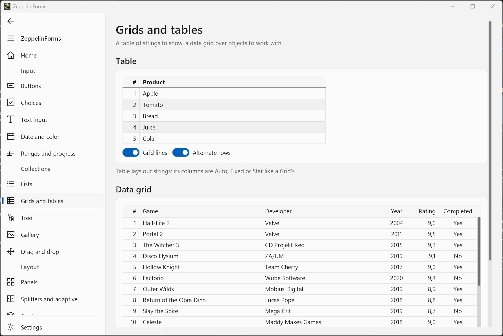
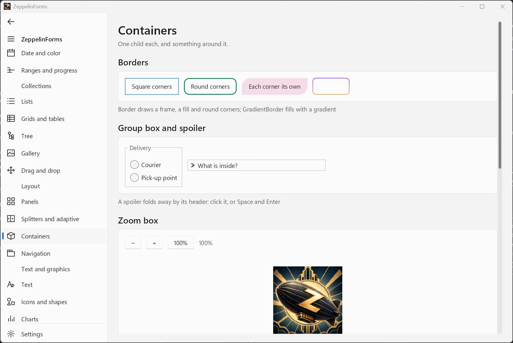
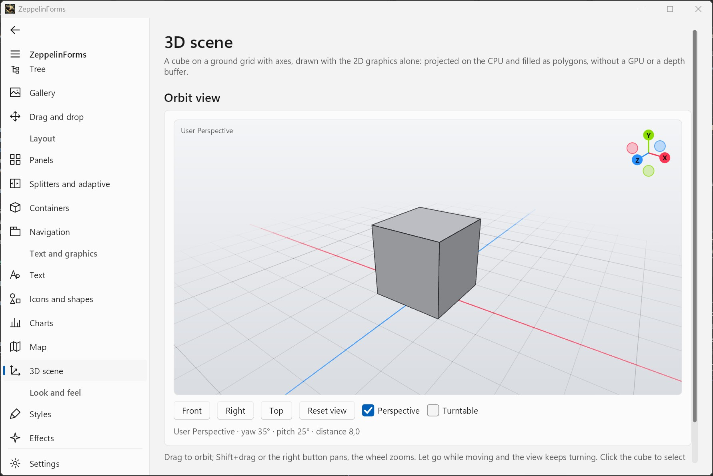

# ZeppelinForms


**ZeppelinForms** (ZF) is an experimental project aimed at creating a simple, platform-independent UI framework with hardware acceleration (on Windows) and straightforward code-behind UI development.

### ⚙️ Current Status






The project is under active development.

The showcase — every control, the styles and the effects — runs in the browser:
**https://yd359team.github.io/**

The documentation is in the [wiki](https://github.com/YD359Team/ZeppelinForms-solution/wiki)
(its source is `docs/wiki`).

| # | Name        | Status |
| - | ----------- | ------ |
| 1 | Headless    | ✅     |
| 2 | Windows     | ✅     |
| 3 | Linux (X11) | ✅     |
| 4 | Linux (Wayland) | ✅     |
| 5 | WebAssembly | ✅*    |
| 6 | Android     | ✅     |
| 7 | macOS       | 💡     |

\* - WebAssembly: dialogs are async-only,
and system drag and drop is not supported — see the browser section below.

Android: dialogs are async-only, and there is no file dialog yet.

### 🐥 TL;DR

| Reason to choose Zeppelin Forms | WinForms | WPF | Avalonia |
|---|:---:|:---:|:---:|
| Cross-platform UI | ✓ | ✓ | |
| Simple code-first UI | | ✓ | ✓ |
| Modern controls out of the box | ✓ | ✓ | |

Completely free. No registration required.

### 🧠 Philosophy

In short: combine the simplicity of WinForms with selected ideas from WPF and Flutter, the cross-platform capabilities of Avalonia, and get rid of tons of legacy baggage along the way.

* No dependency on a specific platform
* No dependency on a specific graphics stack

And if the project is modern, why not take advantage of the full capabilities of .NET 10 and C# 14?

### 🖌️ Rendering

| # | Name      | Status |
| - | --------- | ------ |
| 1 | SkiaSharp | ✅     |
| 2 | GLES      | ✅     |

ZeppelinForms itself knows nothing about Skia, because it is implemented in a separate project, `ZeppelinForms.Skia`. This means that the graphics layer is completely decoupled from the framework logic.

As a result, the framework can be integrated with DirectX or virtually any other graphics stack.

If hardware acceleration is unavailable, the framework falls back to software rendering.

### 📟 Forms

**Forms** are the only type of window in ZeppelinForms, just like in WinForms.

| # | Name                  | Status |
| - | --------------------- | ------ |
| 1 | Debugger              | ✅*     |
| 2 | Overlays              | ✅**    |
| 3 | Toast Notifications   | ✅***   |
| 4 | ToolTips              | ✅      |
| 5 | Dialog Windows        | ✅      |
| 6 | Open/Save File Dialog | ✅****  |
| 7 | MessageBox            | ✅      |
| 8 | InputBox              | ✅      |
| 9 | Clipboard             | ✅      |
| 10 | Folder Dialog        | ✅****  |
| 11 | Drag&Drop (internal) | ✅      |

\* — F12 opens the inspector — the element under the cursor with its margin and padding, and its properties in a property grid — and the accessibility audit \
\*\* — the API will be extended further \
\*\*\* — some limitations and unfinished parts remain \
\*\*\*\* - managed implementation by default; a platform may supply a system picker through `IFilePicker`, as the browser backend does

### 🛣️ Layout

* Supports `Measure` and `Arrange`
* All controls support docking
* Supports horizontal and vertical alignment, including content alignment

### 🧩 Controls

All controls must inherit from `UIElement`, either directly or indirectly through `UnitControl`, `PanelControl`, or `WrapControl`.

There are no WinForms-style components that are not considered actual controls, such as `Timer` or `BackgroundWorker`.

#### UIElement

The common base type for all controls. A form is not a `UIElement`, but its `Content` can be any `UIElement`.

Unlike WinForms, all controls support:

* Internal padding
* Transparency
* Shadows (`box-shadow`)
* Scaling

#### Base class hierarchy

`UIElement` defines geometry, input and painting entry points. Decoration —
background, corner radius, border — lives one level down. Inherit the closest
base that already does what you need:

`Draw` is sealed in every `Decorated*` class: it fills the background, calls
your content, then draws the border. Override these instead:

| Base | Override | Sealed |
| ---- | -------- | ------ |
| `DecoratedControl` | `DrawContent` (required), `DrawDecoration` | `Draw` |
| `DecoratedPanel` | `DrawContent`, `DrawDecoration`, `MeasureContentOverride`, `ArrangeContentOverride` | `Draw`, `MeasureOverride`, `ArrangeOverride` |
| `DecoratedWrapControl` | `DrawContent`, `DrawDecoration` | `Draw` |

`Decorated*` is not a fourth category — it is a decoration layer inside each of
the three. `DecoratedControl` is a `UnitControl`, so it inherits every default
`UnitControl` sets, alignment included.

`DrawContent` runs before children, `DrawDecoration` after them and outside
their clip — that is where selection outlines, resize handles and drop
indicators go. For state-dependent colors override `CurrentBackground` and
`CurrentBorderColor` rather than painting the background yourself.

`Shape` is the one deliberate exception: shapes have their own `Fill` and
`Stroke`, so an inherited `Background` would only confuse.

#### Styled Properties

Any property a theme may set must be declared as a styled property. A plain
auto-property gets overwritten by the theme, is invisible to `PropertyGrid`
and does not trigger a repaint. A source generator expands three lines into
the registration, the backing field and the accessors:

```csharp
[Styled(Category = "Menu")]
public partial Color HoverColor { get; set; }

private static Color HoverColorDefault => new(255, 232, 240, 254);
```

Requirements: the property is `partial` with a getter and a setter, and the type
declaring it is a `partial` descendant of `UIElement`. The default comes from a
static property named `<Name>Default`; omit it when `default(T)` will do.

Flags: `AffectsLayout = true` when the value changes measurement — the setter
then invalidates layout instead of only repainting. `Inherits = true` when the
value cascades down the tree, as `TextColor` does.

Value precedence, highest first — `GetValueSource` tells which one a value came from:

1. set from user code
2. a binding
3. a style — a style sheet, or a `Style` of the application, a form or an element
4. for inherited properties (`Inherits = true`): the nearest ancestor's value of
   one of the three above
5. a theme rule
6. control default — `SetControlDefault` from a constructor
7. the default — the `<Name>Default` property, or `default(T)`

A constructor must use `SetControlDefault`: a plain assignment there would mark
the value as user-set and lock the theme out for good. ZF0006 reports this.

`External = true` when the value lives in another object, as `TextBox.Text` does
in its `TextDocument`. The generator then emits only the registration; the
control writes the accessors itself, routing the setter through
`SetValue(Property, value)` and exposing a `Write<Name>` method for the
registration to call directly.

#### Unit Controls

`UIElement` → `UnitControl`

**Unit controls** are similar to `Control` in WinForms and can be thought of as regular controls. They cannot contain child controls.

|  № | Name                | Status |  № | Name             | Status |
| -: | ------------------- | :----: | -: | ---------------- | :----: |
|  1 | Label               | ✅     |  24 | AutoCompleteBox  | ✅    |
|  2 | Button              | ✅     |  25 | BarChart         | ✅    |
|  3 | CheckBox            | ✅     |  26 | LineChart        | ✅    |
|  4 | PictureBox          | ✅     |  27 | PieChart         | ✅    |
|  5 | RadioButton         | ✅     |  28 | RadarChart       | ✅    |
|  6 | TextBox             | ✅*    |  29 | CandlestickChart | ✅    |
|  7 | ToggleSwitch        | ✅     |  30 | RichLabel        | ✅    |
|  8 | DateTimePicker      | ✅     |  31 | LinkLabel        | ✅    |
|  9 | TimePicker          | ✅     |  32 | HintLabel        | ✅    |
| 10 | ColorPicker         | ✅     |  33 | LineShape        | ✅    |
| 11 | ScrollBar           | ✅     |  34 | RectangleShape   | ✅    |
| 12 | SvgIcon             | ✅     |  35 | EllipseShape     | ✅    |
| 13 | NumericUpDown       | ✅     |  36 | PolygonShape     | ✅    |
| 14 | ProgressBar         | ✅     |  37 | CheckedComboBox  | ✅    |
| 15 | CircularProgressBar | ✅     |  38 | ComboBox         | ✅    |
| 16 | TrackBar            | ✅     |  39 | GridSplitter     | ✅    |
| 17 | RangeSlider         | ✅     |  40 | MaskedTextBox    | ✅    |
| 18 | Calendar            | ✅     |  41 | MapControl       | ✅    |
| 19 | MenuBar             | ✅     |  42 | Loader           | ✅    |
| 20 | MenuList            | ✅     |  43 | PageIndicator    | ✅    |
| 21 | SplitButton         | ✅     |  44 | ImageViewer      | ✅    |
| 22 | ToggleButton        | ✅     |  45 | DataGridView     | ✅**  |
| 23 | TabStrip            | ✅     |     |                  |        |

\* — contains bugs and is missing part of its API \
\*\* — DataGridView: no frozen columns yet

`Button` has the variants `PrimaryButton`, `SecondaryButton` and `DangerButton`.

#### Panels

`UIElement` → `PanelControl`

**Panels** are controls that can contain other controls, including other panels.

| # | Name                   | Status |
| - | ---------------------- | ------ |
| 1 | Panel                  | ✅      |
| 2 | StackPanel             | ✅      |
| 3 | Grid                   | ✅      |
| 4 | DockPanel              | ✅      |
| 5 | TabControl             | ✅      |
| 6 | UniformGrid            | ✅      |
| 7 | VirtualizingStackPanel | ✅      |
| 8 | SplitContainer         | ✅      |
| 9 | PageControl            | ✅      |
| 10 | WrapPanel             | ✅      |
| 11 | Table                 | ✅      |
| 12 | AttachButton          | ✅      |
| 13 | PropertyGrid          | ✅      |
| 14 | SplitView             | ✅      |
| 15 | TreeView              | ✅      |
| 16 | ImageGallery          | ✅      |
| 17 | MarkdownViewer        | ✅      |

##### Items Panels

`UIElement` → `PanelControl` → `ItemsControl`

A specialized type of panel capable of working with collections of elements.

| # | Name           | Status |
| - | -------------- | ------ |
| 1 | ListBox | ✅ |
| 2 | CheckedListBox | ✅ |
| 3 | DragList | ✅ |

⭐ All panels can display a scrollbar when their content overflows, and scroll by
finger with kinetic flings and rubber-band overscroll on touch devices.

#### Wrapper Controls

`UIElement` → `WrapControl`

**Wrapper controls** are controls that can contain a single child control. This concept is unusual in the WinForms world, but familiar from XAML-based frameworks.

| # | Name           | Status |
| - | -------------- | ------ |
| 1 | Border         | ✅    |
| 2 | Spoiler        | ✅    |
| 3 | ZoomBox        | ✅    |
| 4 | GroupBox       | ✅    |
| 5 | LayoutBuilder  | ✅    |
| 6 | Page           | ✅    |
| 7 | GradientBorder | ✅    |
| 8 | GripBox        | ✅    |
| 9 | AdaptiveLayout | ✅    |
| 10 | RefreshContainer | ✅  |

#### Your Own Controls

A control of another package — a PDF view, a chart, a code editor — is written
against the public API alone, as the built-in ones are. Reference the
`ZeppelinForms` package: it brings the generator for `[Styled]` and lists the
assembly's controls for the style sheets.

```csharp
public partial class Swatch : DecoratedControl
{
    public static readonly PseudoClass Chosen = PseudoClass.Register("chosen");

    // in every theme, unless the application's theme has a rule of its own
    static Swatch() =>
        Theme.RegisterDefault<Swatch>(static (swatch, theme) => swatch.Fill = theme.Colors.Accent);

    [Styled(Category = "Appearance")]
    public partial Color Fill { get; set; }

    protected override void DrawContent(Graphics g)
    {
        if (g is SkiaGraphics skia)     // draw with Skia itself, at the element's place
            skia.Canvas.DrawRect(/* … */);
        else
            g.FillRectangle(LocalBounds, Fill);
    }
}
```

| Need                            | API                                                     |
| ------------------------------- | ------------------------------------------------------- |
| The form the element is in      | `FindForm()`                                            |
| Take the keyboard focus         | `Focus()`, `Form.FocusedElement`                        |
| A flyout or a popup             | `FindForm()?.ShowFlyout(anchor, content)`               |
| A theme rule for every theme    | `Theme.RegisterDefault<T>(…)`                           |
| A state for style sheets        | `PseudoClass.Register`, `SetPseudoClass`                |
| Input method composition        | `ITextCompositionTarget`, `ReportTextInputArea(caret)`  |
| Copy / paste menu of its own    | override `GetDefaultContextMenu()`                      |
| Draw with Skia directly         | `SkiaGraphics.Canvas`                                   |

`tests/ZeppelinForms.ExternalControlTests` builds such controls without access to
the framework's internals, so a member they need can't quietly turn internal.

### 🎄 Themes

Built-in light and dark themes are included. A theme is a set of appliers
matched by control type; they are applied from the base type down, so a
specific applier extends the base one instead of replacing it.

A theme never overwrites a value set from user code — see Styled Properties
above for the full precedence. `ClearValue` gives a property back to the theme.

Also available fluent and high contrast themes!

### 🎞️ Motion

Transitions belong to the property system, not to individual controls. A rule on
a property makes assignment the target while the visible value travels to it:

```csharp
card.Transitions.Add(Transition.Ease(UIElement.BackgroundProperty, 200));
list.ChildrenLayoutTransition = LayoutTransition.Speed();
list.ChildrenEnterTransition = VisibilityTransition.Slide(220, 0f, -12f);
list.ChildrenExitTransition = VisibilityTransition.Fade(160);
```

Reading a property returns the target — bindings and logic never see a halfway
value — while the intermediate value is handed out inside drawing only.

Layout travel works by the FLIP rule: an element the layout moved is already in
its new place but is drawn from the old one. Nothing in the controls knows about
it, because expanding a tree node, reflowing a `WrapPanel` and inserting into a
`DragList` are all the same event: a changed position in `Arrange`.

`Motion.Preference` follows the system setting where the platform has one, and
reduced motion makes all of the above instant while leaving scroll inertia and
loading indicators alone.

### 🔗 Bindings

Any styled property can be bound to a property of any object:

```csharp
nameBox.Bind(TextBox.TextProperty, user, nameof(User.Name), BindingMode.TwoWay);
statusLabel.Bind(Label.TextProperty, user, nameof(User.Status));
saveButton.Bind(UIElement.IsEnabledProperty, user, nameof(User.HasChanges));
```

`OneWay` follows the source; `TwoWay` also writes back. A source implementing
`INotifyPropertyChanged` pushes its changes to the target — without it a binding
only reads the source once, when it is created.

A binding holds its target weakly, so a model outliving a window does not keep
that window alive. `Unbind` drops one property, `UnbindAll` drops them all, and
`ClearValue` removes the binding together with the value.

Assigning a bound property from code wins over the binding: in `TwoWay` the
value goes to the source, in `OneWay` the binding is broken — otherwise the next
source change would silently overwrite what was just written.

### 🛠️ Getting Started

The UI references the `ZeppelinForms` package; the application references the package
of its platform as well, which brings the framework with it:

| Platform    | Package                 | Started by                                   |
| ----------- | ----------------------- | -------------------------------------------- |
| Windows     | `ZeppelinForms.Windows` | `new App(new WindowsPlatform())` (namespace `ZeppelinForms.Windows`) |
| Linux (X11) | `ZeppelinForms.Linux`   | `new App(new X11Platform())` (namespace `ZeppelinForms.Linux`) |
| Browser     | `ZeppelinForms.Browser` | `BrowserApp.RunAsync(…)`                     |
| Android     | `ZeppelinForms.Android` | `AndroidApp.Run(activity, …)`                |

A desktop application is a `WinExe` (Windows) or `Exe` project for `net10.0`; see
[ZF_ProcessMonitor](https://github.com/YD359Team/ZF_ProcessMonitor) for a complete one.

Creating an application in Windows:

```csharp
public class Program
{
    [STAThread]   // drag and drop from other applications needs a single-threaded apartment
    static void Main()
    {
        WindowsPlatform windowsPlatform = new();
        App myApp = new(windowsPlatform)
        {
            MainForm = new MainForm(),
            StartupTheme = Themes.FluentLight,   // optional: the theme to start with
            Icon = Icon.FromFile(Path.Combine(Assets.Root, "app.ico")),  // optional
        };
        myApp.Run();
    }
}
```

Creating an application in Linux (X11):

```csharp
public class Program
{
    static void Main()
    {
        X11Platform linuxPlatform = new();
        App myApp = new(linuxPlatform)
        {
            MainForm = new MainForm()
        };
        myApp.Run();
    }
}
```

Creating an application in the browser (WebAssembly):

```csharp
public class Program
{
    static Task Main() => BrowserApp.RunAsync(
        () => new MainForm(),
        font: "/fonts/Inter-Regular.ttf",
        preload: ["/Assets/Logo.png"]);
}
```

A factory is passed rather than a form instance: a form measures text in its
constructor, and the text measurer only exists once the platform has been created.

The browser has no system fonts and no local file system, so `font` and `preload`
name files served from `wwwroot`. `BrowserApp` downloads them into the virtual
file system before the first form is built, after which `Image.LoadAsset` and
`Font.WithFile` work exactly as they do on the desktop.

Two host files are needed alongside the application. `wwwroot/index.html`:

```html
<body>
    <canvas id="zf-canvas"></canvas>
    <script type="module" src="main.js"></script>
</body>
```

and `wwwroot/main.js`, which loads the runtime and wires up the JavaScript module:

```javascript
import { dotnet } from "./_framework/dotnet.js";
import * as zf from "./zf.js";

const runtime = await dotnet.create();
runtime.setModuleImports("zf", { ...zf });

const exports = await runtime.getAssemblyExports("ZeppelinForms.Browser");
globalThis.zfExports = exports.ZeppelinForms.Browser.Interop;

await runtime.runMain();
```

`zf.js` ships with `ZeppelinForms.Browser` and has to be copied into the
application's `wwwroot`. See `examples/ZF Wasm` for a complete project.

On Android `AndroidApp.Run(this, () => new MainForm(), assets: ["logo.png"])` is called
from the activity's `OnCreate`; the files named in `assets` are copied out of the APK's
assets so that `Assets.Root` finds them. See `examples/ZF Android`.

### 📁 Files and Assets

| File | What it is | How it is used |
| ---- | ---------- | -------------- |
| `.zss` | Style sheet: CSS-like rules over the controls and their properties | `App.Styles.Load(path, watch: true)`, `form.Styles.Add(StyleSheet.LoadAsset("app.zss"))`, `StyleSheet.Parse(text)` |
| `.zfml` | Markup: a tree of controls compiled into C# at build time | picked up by the package's build on its own — no project change |
| `.ico` | Window and application icon | `Icon.FromFile(path)` — `Icon` reads ICO files only, not PNG |
| `.png`, `.jpg`, `.webp`, `.gif`, `.bmp` | Images | `Image.LoadAsset("logo.png")`, `Image.LoadFromFile`, `Image.LoadFromUri` |
| `.ttf`, `.otf` | Fonts | `Font.Default.WithFile(path)` |

SVG files are not read; vector icons are given as SVG path data, `IconSource.FromPath(…)`.

**Assets** are looked up in `Assets.Root`, the `Assets` folder next to the executable.
They are not copied there by themselves; the project copies them:

```xml
<ItemGroup>
  <None Include="Assets\**\*" CopyToOutputDirectory="PreserveNewest" />
</ItemGroup>
```

**Style sheets** in short:

```css
$radius: 6;

Button.primary {
    BackgroundColor: @Accent;            /* a theme color */
    CornerRadius: $radius;
    transition: BackgroundColor 150ms ease-out;

    &:hover { BackgroundColor: @AccentHover; }
}

DataGridView { ShowAlternateRows: true; }
```

Property names are the C# ones (or the same in kebab case), values are written as the
C# would construct them (`Padding: 14 6`). A mistake skips its declaration and is
reported with its file, line and column; the Visual Studio extension highlights `.zss`
and lists the problems in the Error List. `watch: true` reloads a sheet on every save.

The styles of `.zfml` markup (`<Type.Styles>`) are checked the same way when the file
is opened or saved: the host parses them as the sheet the application builds from
them, and a value that can't be read, an easing or a pseudo-class nobody has goes to
the Error List at its line of the markup. Their shape and the controls and properties
they name are the build's — ZF2012 and ZF2013 — and aren't reported twice.

**Icons.** `App.Icon` is the icon of every form without one of its own and of the
taskbar button; without it the ZeppelinForms logo is used. `Form.Icon` overrides it
for one window and can be changed while the window is open. The icon of the executable
itself — the one Explorer shows and a pinned taskbar button keeps — is set in the
project file:

```xml
<PropertyGroup>
  <ApplicationIcon>Assets\app.ico</ApplicationIcon>
</PropertyGroup>
```

### 📺 Previewer

The **ZeppelinForms Tools** extension for Visual Studio 2022 (17.10 and later) and
Visual Studio 2026: the `.vsix` is attached to every release. It runs on the machine's
.NET 10.

`Ctrl`+`Alt`+`Shift`+`P` (View › Other Windows › ZeppelinForms Preview) shows the
preview of the active project: every form with a parameterless constructor, and every
method marked `[Preview]` (namespace `ZeppelinForms.Design`). What `Main` does before
showing a form — loading style sheets, choosing a theme — goes into a `[PreviewSetup]`
method. The extension also highlights `.zss` style sheets and reports their problems in
the Error List. See `tools/ZeppelinForms.VisualStudio/README.md`.

### 📝 Markup

Code-first is the main way, and markup is an option for the parts that read better as a
tree. A `.zfml` file names its class with `x:Class`; at build time the generator turns it
into C# — a field for every `x:Name` and an `InitializeComponent()` of plain `new`,
assignments, `+=` and `Add`. No reflection, so trimming and native AOT keep it all.

```xml
<StackPanel x:Class="MyApp.SignUpCard"
            xmlns="https://zeppelinforms.dev/markup"
            xmlns:x="https://zeppelinforms.dev/markup/x"
            xmlns:my="using:MyApp.Controls"
            Orientation="Vertical" Spacing="10">
  <TextBox x:Name="NameBox" Watermark="Your name" Size="260,NaN"/>
  <Label Text="{Bind NameBox.Text}"/>
  <PrimaryButton Text="Sign up" Classes="wide" Click="OnSubmit"/>
  <my:Gauge Level="0.5"/>
</StackPanel>
```

```csharp
public partial class SignUpCard
{
    private void OnSubmit(object? sender, MouseClickEventArgs e) { /* NameBox.Text … */ }
}
```

- Values are written as in style sheets: `Padding="14 6"` is `new Thickness(14, 6)`,
  `Size="260,NaN"`, `Background="#0d6efd"`, enum members, static members by name
- Children go to the first property that takes them — one marked `[Content]`, then
  `Children`, `Items`, `Nodes`, `Content`, `Child`; `<Border.Child>` names one
- `{Bind Name.Property}` binds a styled property to a named element, `Mode=TwoWay`
  both ways; `{x:Null}` is null; `<x:String>` is a text item of a list
- An unknown type, property, event or value is a ZF2xxx error at its line of the
  markup, and so is a handler of the wrong signature
- A class whose code declares no constructor gets one that calls
  `InitializeComponent`; Hot Reload builds the markup again after an edit

### 🔥 Hot Reload

Visual Studio's Hot Reload and `dotnet watch` work with code-first forms. After every
applied edit the open forms restyle, measure and redraw everything, so an edited `Draw`,
`MeasureOverride` or theme rule shows at once, and pages made by factories — the entries
of a `SplitView`, the pages of a `PageControl` — are made again when their assembly
changed. A form built in its constructor builds itself again in `OnHotReload`:

```csharp
public class MainForm : Form
{
    public MainForm()
    {
        Title = "Orders";
        Content = CreateContent();
    }

    private UIElement CreateContent() => new StackPanel { /* ... */ };

    protected override void OnHotReload(HotReloadEventArgs e) =>
        Content = CreateContent();
}
```

`UIElement.OnHotReload` does the same for a control that builds its children itself, and
`HotReload.Applied` is raised once the forms have caught up. Style sheets loaded from
files with `watch: true` follow their saves on their own.

### 🧪 Snapshot Tests

Reference snapshots are stored in:

`tests/ZeppelinForms.UnitTests/Snapshots/Expected/{win,linux}`

Text rendering differs between platforms, so separate snapshot sets are maintained for Windows and Linux.

Local snapshot update:
- bash: `ZF_UPDATE_SNAPSHOTS=true dotnet test`
- PowerShell: `$env:ZF_UPDATE_SNAPSHOTS='true'; dotnet test`

`ZF_CREATE_SNAPSHOTS=true` only adds the missing ones, leaving the existing as they are.

### 📈 Benchmarks

`bench/ZeppelinForms.Benchmarks` measures layout, rendering, text and the
scrolling of a virtualized list against a stored baseline:

```powershell
dotnet run --project bench/ZeppelinForms.Benchmarks -c Release
dotnet run --project bench/ZeppelinForms.Benchmarks -c Release -- --update-baseline
```

Run-to-run spread on a desktop machine reaches tens of percent, so a single run
proves nothing: take the median of three, and record a baseline only from a quiet
machine. Current numbers are in the release entry in `CHANGELOG.md`.

### ✈️ Platform Verification

The following environments have been used for manual testing and validation.

**Windows**
- Windows 11 Pro 26H2

**Linux (X11)**
- Debian under WSL2
- Ubuntu 26.04.1 LTS (x86-64, VirtualBox)

**WebAssembly (WASM)**
- Yandex Browser (desktop)
- Yandex Browser (mobile)
- Brave (mobile)

**Android**
- Android Emulator (Pixel device profile, Visual Studio)

**Continuous Integration**

- See the CI workflow configuration for the operating systems and environments used in automated builds and tests.


---

ZeppelinForms. Fully free. For everyone.
